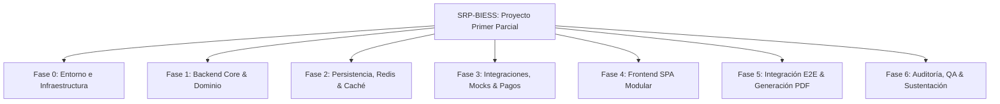
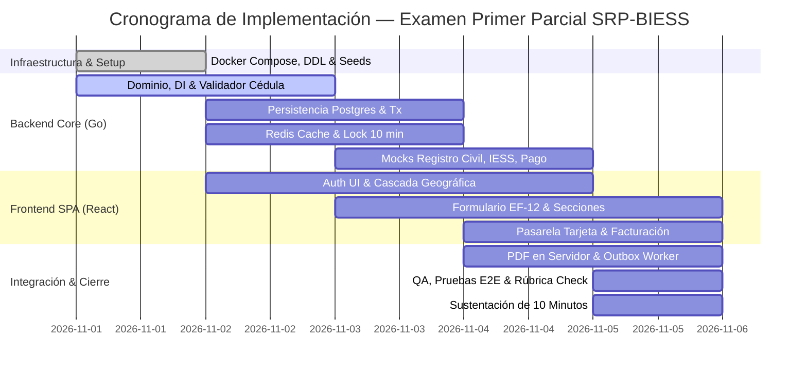

# Plan de Proyecto y Ejecución (Project Planning) — SRP-BIESS

| Metadato | Detalle |
|---|---|
| **Proyecto** | Sistema de Registro y Postulación al Directorio del BIESS (SRP-BIESS) |
| **Documento** | Plan de Implementación, Cronograma y Gestión de Entrega |
| **Asignatura** | Frameworks de Programación Web — Examen Práctico del Primer Parcial |
| **Ponderación** | 40 Puntos (100% de la evaluación práctica) |
| **Versión** | 1.0 |
| **Fecha de emisión** | 31/10/2026 |
| **Duración estimada** | 5 días intensivos (Sprints diarios / hitos de entrega) |

---

## 1. Objetivos del Plan

1. **Alineación 100% con la Rúbrica:** Garantizar la obtención de los 40 puntos cubriendo rigurosamente las 6 dimensiones evaluadas (Backend DI, PostgreSQL Tx, Redis Caching/Rate Limit, Frontend SPA, Consumo Asíncrono y Reglas de Negocio EF-11/EF-12).
2. **Desarrollo Desacoplado y Paralelo:** Permitir que los integrantes trabajen en paralelo (Backend, Base de Datos, Frontend SPA e Integraciones) sin bloquearse, guiados por los contratos de `Docs/SDD/07-diseno-api-rest.md`.
3. **Calidad y Trazabilidad:** Mantener historial de commits ordenados bajo convención estándar y cobertura de pruebas unitarias e integración.
4. **Preparación de la Sustentación:** Asegurar que cada miembro del equipo domine la arquitectura para la defensa oral de 10 minutos.

---

## 2. Alineación con la Rúbrica de Evaluación (Base 40 Puntos)

| Dimensión | Puntos | Entregable Clave en el Plan | Hito / Fase |
|---|---|---|---|
| **1. Arquitectura Backend & DI (Go)** | 8.0 pts | Arquitectura limpia (Handler → Service → Repository), inyección manual en `main.go`. | Fase 1 y Fase 2 |
| **2. Persistencia Relacional & Transacciones** | 8.0 pts | DDL relacional normalizado, `TxManager` con `BEGIN/COMMIT/ROLLBACK` atómico. | Fase 1 y Fase 3 |
| **3. Caché, Expiración & Rate Limiting (Redis)** | 6.0 pts | Bloqueo 10 min por 3 intentos fallidos (Lua/Redis) + caché catálogos con TTL. | Fase 2 |
| **4. Frontend SPA (Vite + React + Tailwind)** | 6.0 pts | SPA modular, feedback inmediato (loaders, alertas), validación reactiva. | Fase 4 |
| **5. Consumo de API & Manejo Asíncrono** | 6.0 pts | Rutas protegidas (JWT en cookie), estados loading/error, TanStack Query. | Fase 4 y Fase 5 |
| **6. Cumplimiento de Reglas del Negocio (IESS)** | 6.0 pts | EF-11, EF-12, simulación dactilar, nacionalidad ecuatoriana, cascada país/provincia/cantón. | Fase 3, 4 y 5 |
| **Total** | **40.0 pts** | | |

---

## 3. Estructura de Desglose de Trabajo (WBS / EDT)

### Fase 0: Setup, Infraestructura y Contenerización (Día 1 - Mañana)
* [x] **T0.1:** Creación de estructura de directorios (`backend/`, `frontend/`, `Docs/`, `deploy/`).
* [ ] **T0.2:** Configuración de `docker-compose.yml` (PostgreSQL 16, Redis 7, Mailpit para correos de prueba).
* [ ] **T0.3:** Creación y ejecución del script DDL semilla inicial (`db/init.sql`) con países, provincias, cantones, cargos y preguntas de inhabilidad.
* [ ] **T0.4:** Definición de plantillas de entorno (`.env.example` para backend y frontend).
* [ ] **T0.5:** Inicialización del repositorio Git con `.gitignore` unificado (Go, Node, dist, logs).

### Fase 1: Arquitectura Backend en Go e Inyección de Dependencias (Día 1 - Tarde / Noche)
* [ ] **T1.1:** Setup del proyecto Go con Fiber v2 (`go.mod`, configuración centralizada con `godotenv`).
* [ ] **T1.2:** Implementación de paquetes de Dominio (`domain/postulante.go`, `domain/postulacion.go`, `domain/catalogo.go`).
* [ ] **T1.3:** Implementación del validador algorítmico nativo de cédula ecuatoriana Módulo 10 (`pkg/validator/cedula.go` - ADR-013).
* [ ] **T1.4:** Creación de la capa de repositorios en PostgreSQL con `pgx/v5` (`repository/postgres/...`).
* [ ] **T1.5:** Implementación del `TxManager` para gestión transaccional explícita (`WithTx`).
* [ ] **T1.6:** Estructuración del Composition Root (`cmd/api/main.go`) con inyección de dependencias manual.

### Fase 2: Redis Caching, Rate Limiting y Autenticación EF-11 (Día 2)
* [ ] **T2.1:** Implementación de `CatalogoCache` en Redis con estrategia cache-aside y TTL de 24h con jitter.
* [ ] **T2.2:** Implementación de `AttemptRepository` en Redis: script Lua atómico para conteo de intentos y bloqueo temporal de 10 min tras 3 fallos consecutivos (EF-11).
* [ ] **T2.3:** Servicio de hashing de contraseñas con Argon2id y servicio de tokens JWT (access de 15 min + refresh en cookie HttpOnly).
* [ ] **T2.4:** `AuthHandler` con endpoints:
  * `POST /api/v1/auth/registro/validar-identidad`
  * `POST /api/v1/auth/registro`
  * `POST /api/v1/auth/login`
  * `POST /api/v1/auth/recuperar-password` y `POST /api/v1/auth/restablecer-password`
* [ ] **T2.5:** Middleware de autenticación JWT y manejo global de errores JSON.

### Fase 3: Reglas de Negocio EF-12, Mocks de Integración y Pagos (Día 3)
* [ ] **T3.1:** Implementación de adaptadores de interoperabilidad:
  * `IdentityProvider` (Registro Civil: simulación de biometría dactilar y fecha de expedición).
  * `EmploymentHistoryProvider` (IESS: verificación de condición de afiliado, jubilado o empleador).
* [ ] **T3.2:** Implementación de `PaymentGateway` y `InvoicingService` (ADR-014):
  * Algoritmo de validación de tarjeta (Luhn).
  * Adaptador `MockPaymentGateway` (aprobado vs. fondos insuficientes).
  * Generador de clave de acceso de 49 dígitos del SRI y comprobante digital.
* [ ] **T3.3:** Servicios de postulación multi-sección:
  * Validación estricta de nacionalidad ecuatoriana (cierre si es extranjera).
  * Validación de cargo vs. calidad IESS.
  * Calculadora de experiencia laboral (años, meses, días).
  * Cuestionario de inhabilidades (13 preguntas con efectos bloqueantes y de alerta).
* [ ] **T3.4:** Servicio transaccional de envío de postulación (`SubmitService`):
  * Generación de código único `BIESS-{AÑO}-{SECTOR}-{SECUENCIA}`.
  * Inserción en outbox de notificaciones en la misma transacción atómica.

### Fase 4: Frontend SPA (React + Vite + Tailwind CSS) (Días 3 y 4)
* [ ] **T4.1:** Setup del proyecto Vite con React 18/19, TypeScript y Tailwind CSS.
* [ ] **T4.2:** Configuración de cliente HTTP Axios/Fetch con interceptores para renovación automática de token (Refresh Token) y manejo de errores 401/423/429.
* [ ] **T4.3:** Módulo de Autenticación (EF-11):
  * Pantalla de bienvenida con selector de flujo ("Iniciar Sesión" / "Registrarse").
  * Modal/Formulario de comprobación de identidad (cédula + fecha de expedición / código dactilar).
  * Visualización reactiva del bloqueo de cuenta con temporizador regresivo de 10 minutos.
* [ ] **T4.4:** Módulo de Postulación Dinámico (EF-12):
  * Barra de progreso y navegación por secciones.
  * Datos personales precargados desde Registro Civil (solo lectura).
  * Cascada geográfica reactiva: selector País → Provincia → Cantón (con carga manual si país $\ne$ Ecuador).
  * Formulario de formación académica, experiencia y publicaciones con modales de carga de documentos PDF.
  * Cuestionario interactivo de inhabilidades y módulo de consentimiento informado.
* [ ] **T4.5:** Pantalla de Checkout / Pago de Arancel (ADR-014):
  * Formulario reactivo de tarjeta de crédito/débito con detección visual de franquicia (Visa/Mastercard) y validación en tiempo real.
  * Visualización y descarga inmediata de la factura electrónica emitida.

### Fase 5: Generación de PDF, Outbox Worker y Pruebas (Día 4 - Noche)
* [ ] **T5.1:** Generación en servidor del PDF del Formulario de Postulación con plantilla institucional y marcas para firma física.
* [ ] **T5.2:** Worker en segundo plano para despacho de correos pendientes desde `notificacion` (Outbox) hacia Mailpit / SMTP.
* [ ] **T5.3:** Pruebas unitarias en Go para:
  * Validador Módulo 10 de cédula.
  * Validador de Luhn para tarjetas.
  * Calculadora de experiencia.
* [ ] **T5.4:** Pruebas de integración para transacciones de PostgreSQL (verificación de rollback ante fallo de inserción de documentos o pagos).
* [ ] **T5.5:** Pruebas de resiliencia ante caída de Redis (fallback a PostgreSQL en catálogos y fail-closed en autenticación).

### Fase 6: Auditoría, Documentación Final y Ensayo de Sustentación (Día 5)
* [ ] **T6.1:** Redacción exhaustiva del `README.md` principal con instrucciones de arranque con `docker-compose up` y variables `.env`.
* [ ] **T6.2:** Verificación de ramas Git ordenadas (`main`, `develop`, `feature/backend-di`, `feature/redis-cache`, `feature/frontend-spa`) y mensajes de commit claros.
* [ ] **T6.3:** Checklist de sustentación oral de 10 minutos y distribución de temas por integrante.
* [ ] **T6.4:** Grabación o simulación de la demo funcional respondiendo a cada punto de la rúbrica de 40 puntos.

---

## 4. Cronograma Detallado y Ruta Crítica

---

## 5. Matriz de Asignación de Responsabilidades (RACI) — Equipo de 4 Integrantes

El proyecto se divide de forma equilibrada entre los 4 integrantes del equipo:
* **Paulo Rafael Orrala Arriaga (Backend Lead & Inyección de Dependencias):** Arquitectura por capas desacoplada en Go Fiber, *Composition Root*, handlers, routers y middlewares de seguridad.
* **Angel Alejandro Villon Panimboza (Data & Persistence Lead):** Modelado DDL relacional en PostgreSQL, transacciones atómicas con `TxManager` (`BEGIN/COMMIT/ROLLBACK`), control de concurrencia optimista y gestión de persistencia.
* **Carlos Fernando Patiño Garcia (Frontend SPA Lead):** UI modular en React + Vite + Tailwind CSS, consumo asíncrono, rutas protegidas, gestión de estado y cascada reactiva País $\to$ Provincia $\to$ Cantón.
* **Jose Daniel Gonzalez Cochea (Cache, Integraciones, Pagos & QA):** Redis (bloqueo de 10 min por 3 intentos y caché con TTL), validador Módulo 10, Mocks de Registro Civil e IESS, pasarela de pago (Luhn), facturación electrónica SRI y PDF.

| Tarea / Componente | Paulo Rafael Orrala (Backend Lead) | Angel Alejandro Villon (Data Lead) | Carlos Fernando Patiño (Frontend SPA) | Jose Daniel Gonzalez (Cache & QA) |
|---|:---:|:---:|:---:|:---:|
| Arquitectura en capas e Inyección de Dependencias en Go (`main.go`) | **R / A** | C | I | C |
| Transacciones atómicas multi-tabla en PostgreSQL (`TxManager`) | C | **R / A** | I | C |
| Bloqueo en Redis (10 min) y Caché con TTL de catálogos | C | I | C | **R / A** |
| Componentes React, Tailwind CSS y estados reactivos | I | I | **R / A** | C |
| Consumo asíncrono, rutas protegidas y manejo de errores UI | C | I | **R / A** | C |
| Cascada geográfica País → Provincia → Cantón en frontend | I | I | **R / A** | I |
| Algoritmo Módulo 10 de cédula ecuatoriana y validador Luhn | C | I | C | **R / A** |
| Mocks de Registro Civil, Historial Laboral IESS y Pago/Factura SRI | C | C | I | **R / A** |
| Generación de PDF institucional en servidor y Outbox worker | I | C | C | **R / A** |
| Plan de pruebas, verificación de rúbrica y guion de sustentación | C | C | C | **R / A** |

*Leyenda:* **R** = Responsable de ejecución, **A** = Aprobador / Dueño del entregable, **C** = Consultado, **I** = Informado.

---

## 6. Estrategia de Ramas y Convención de Commits

Para cumplir con el criterio de entrega del repositorio (*"historial de commits y ramas ordenadas"*):

### Estructura de Ramas
* `main`: Código estable y probado para entrega final y sustentación.
* `develop`: Rama de integración continua donde se integran las PRs.
* Ramas de características (*feature branches*) distribuidas por integrante:
  * **Paulo Rafael Orrala Arriaga:** `feature/backend-clean-arch`, `feature/auth-jwt-di`
  * **Angel Alejandro Villon Panimboza:** `feature/postgres-transactions-ddl`, `feature/outbox-persistence`
  * **Carlos Fernando Patiño Garcia:** `feature/frontend-spa-ui`, `feature/cascading-selects-forms`
  * **Jose Daniel Gonzalez Cochea:** `feature/redis-cache-lock`, `feature/mocks-payments-invoicing`

### Convención de Commits (Conventional Commits)
* `feat(...)`: Nueva funcionalidad (ej. `feat(auth): implementar bloqueo temporal en redis tras 3 intentos`).
* `fix(...)`: Corrección de errores (ej. `fix(cedula): corregir calculo de decena superior en modulo 10`).
* `docs(...)`: Cambios en documentación (ej. `docs(sdd): anadir adr-014 para pagos y facturacion`).
* `refactor(...)`: Mejoras de código sin cambiar comportamiento (ej. `refactor(di): desacoplar repositorios mediante querier`).
* `test(...)`: Incorporación de pruebas unitarias o de integración.

---

## 7. Guion y Ensayo para la Sustentación Oral (10 Minutos — 4 Integrantes)

Cada integrante cuenta con **2 minutos y 30 segundos** para demostrar su dominio técnico frente al docente:

| Tiempo | Dimensión Evaluada | Expositor | Demostración Práctica en Vivo / Código |
|---|---|---|---|
| **00:00 - 02:30** | **1. Arquitectura Backend & DI (8 pts)** | **Paulo Rafael Orrala Arriaga** | Abre `cmd/api/main.go` (Composition Root), explica la inyección de dependencias desacoplada (Handler $\to$ Service $\to$ Repository) y el manejo de errores nativos en Go. |
| **02:30 - 05:00** | **2. Persistencia Transaccional & Rollback (8 pts)** | **Angel Alejandro Villon Panimboza** | Muestra el script DDL normalizado en PostgreSQL, explica el `TxManager` y demuestra en vivo una inserción multi-tabla con rollback atómico ante fallo simulado. |
| **05:00 - 07:30** | **3. Frontend SPA & Consumo Asíncrono (12 pts)** | **Carlos Fernando Patiño Garcia** | Demuestra la SPA en React + Vite + Tailwind: navegación reactiva, feedback visual inmediato (loaders y alertas de error), protección de rutas por token JWT en cookie y la cascada reactiva País $\to$ Provincia $\to$ Cantón. |
| **07:30 - 10:00** | **4. Redis, Reglas IESS, Pagos & PDF (12 pts)** | **Jose Daniel Gonzalez Cochea** | Demuestra en vivo los 3 intentos fallidos y el bloqueo de 10 min en Redis (`redis-cli`), el algoritmo de cédula Módulo 10, simulación de pago con tarjeta (Luhn), emisión de factura con clave SRI y generación del PDF final. |

---

## 8. Definición de Terminado (Definition of Done - DoD)

Una tarea se considera formalmente **completada** cuando:
1. El código compila sin errores ni advertencias de linters (`golangci-lint` en Go, `eslint` en React).
2. Se adhiere estrictamente a las interfaces y tipos definidos en el SDD.
3. Se han ejecutado y aprobado las pruebas unitarias e integración asociadas.
4. Ha sido revisada mediante *Pull Request* e integrada en la rama `develop`.
5. Cuenta con variables de entorno documentadas en `.env.example`.
6. Es operable localmente mediante `docker-compose up`.
