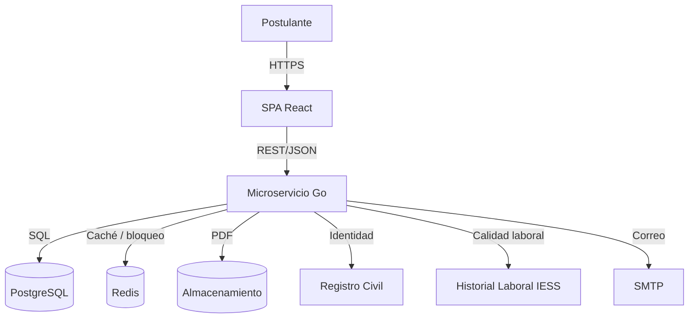
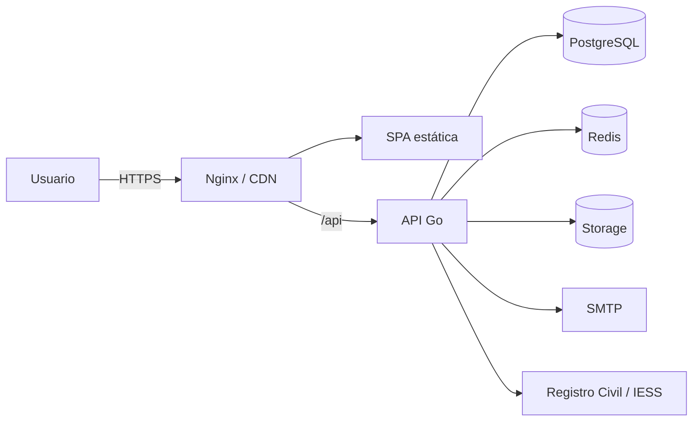

# 02. Descripción general — SDD

## 2.1 Contexto del sistema

El SRP-BIESS es un servicio backend consumido por una SPA y apoyado en servicios externos. La siguiente figura muestra el contexto:

### Fronteras

- **Dentro:** SPA, API, base de datos, caché, almacenamiento, worker de notificaciones.
- **Fuera:** Registro Civil, Historial Laboral IESS, SMTP institucional, infraestructura de red.

---

## 2.2 Actores y componentes

| Actor / componente | Responsabilidad |
|---|---|
| Postulante | Usa la SPA para registrarse y postular. |
| SPA | Presentación, validación de formularios, estado, rutas. |
| API | Autenticación, reglas de negocio, persistencia, PDF, correo. |
| PostgreSQL | Fuente de verdad relacional. |
| Redis | Caché, bloqueo, rate limiting, tokens temporales. |
| Almacenamiento | PDF de respaldo y formularios generados. |
| Registro Civil | Validación de identidad. |
| Historial Laboral IESS | Validación de afiliación, jubilación o empleador. |
| SMTP | Entrega de correos. |

---

## 2.3 Funciones y módulos internos

| Módulo | Funciones | Dependencias |
|---|---|---|
| **Auth** | Registro, login, refresh, logout, recuperación, bloqueo. | PostgreSQL, Redis, Registro Civil, SMTP. |
| **Catálogo** | Países, provincias, cantones. | PostgreSQL, Redis. |
| **Postulación** | Borrador, secciones, elegibilidad, guardado, envío. | PostgreSQL, Redis, IESS, storage, PDF, SMTP. |
| **Documentos** | Carga, validación, almacenamiento, descarga. | Storage, PostgreSQL. |
| **Notificaciones** | Outbox y envío de correos. | SMTP, PostgreSQL. |
| **Auditoría** | Registro de eventos y cambios. | PostgreSQL. |
| **Común** | Config, logger, validación, errores, seguridad. | — |

---

## 2.4 Impulsores de arquitectura

| ID | Impulsor | Decisión |
|---|---|---|
| DA-01 | Separación estricta de responsabilidades. | Capas y puertos/adaptadores. |
| DA-02 | Inyección de dependencias verificable. | Wiring manual en `main.go`. |
| DA-03 | Transacciones atómicas. | `TxManager` y repositorios transaccionales. |
| DA-04 | Bloqueo de intentos y caché. | Redis con claves y TTL explícitos. |
| DA-05 | Formulario largo y recuperable. | Guardado por secciones y estado de UI. |
| DA-06 | Documentos PDF. | Servicio de almacenamiento abstracto. |
| DA-07 | Seguridad y LOPDP. | JWT, Argon2id, consentimiento, auditoría. |
| DA-08 | Demostración académica. | Mocks de integraciones y Docker Compose. |

---

## 2.5 Restricciones y supuestos

### Restricciones

- Stack Go/Fiber, React/Vite/Tailwind, PostgreSQL y Redis.
- PDF con límites de 2 MB, 4 MB y 50 MB total.
- Bloqueo de 3 intentos / 10 minutos.
- Nacionalidad ecuatoriana obligatoria.
- Idioma español y zona horaria `America/Guayaquil`.

### Supuestos

- Los servicios externos exponen REST/JSON o se simulan.
- La fase de postulación se controla por configuración.
- El correo es el canal oficial.
- El almacenamiento local es aceptable para desarrollo.
- El navegador soporta descarga de PDF y HTTPS.

---

## 2.6 Atributos de calidad prioritarios

| Atributo | Escenario | Decisión |
|---|---|---|
| **Seguridad** | Suplantación o fuerza bruta. | Validación de identidad, bloqueo, rate limiting, tokens seguros. |
| **Integridad** | Falla a mitad del envío. | Transacción atómica y rollback. |
| **Rendimiento** | Catálogos consultados masivamente. | Redis cache-aside. |
| **Usabilidad** | Formulario largo en móvil. | Stepper, guardado por sección, responsive. |
| **Mantenibilidad** | Cambio de proveedor de correo. | Puerto `EmailSender` y adaptador. |
| **Trazabilidad** | Auditoría de cambios. | `auditoria_evento` y `trace_id`. |
| **Disponibilidad** | Redis caído. | Fallback de catálogos y fail-closed de auth. |

---

## 2.7 Contexto de despliegue

- La SPA se sirve como archivos estáticos.
- La API se despliega en contenedores con 2+ réplicas.
- PostgreSQL y Redis son servicios administrados o contenedores persistentes.
- El almacenamiento puede ser local o S3 compatible.

---

## 2.8 Límites de la fase

| Fase | Incluye | No incluye |
|---|---|---|
| **Primer parcial** | EF-11, EF-12, catálogos, documentos, correo, auditoría. | EF-13, EF-14, méritos, oposición, reconsideraciones. |
| **Futuro** | Administración, evaluación, calificación, reportes. | — |

---

## 2.9 Resumen de la solución

| Problema | Solución |
|---|---|
| Registro inseguro | Validación de identidad + Argon2id + bloqueo. |
| Pérdida de avance | Borrador + guardado por sección. |
| Datos inconsistentes | PostgreSQL + transacciones + restricciones. |
| Catálogos lentos | Redis cache-aside. |
| Documentos dispersos | Storage + validación PDF + metadatos. |
| Falta de evidencia | Auditoría + `trace_id` + outbox. |
| Formulario complejo | SPA con stepper, RHF + Zod, TanStack Query. |
| Integraciones no disponibles | Adaptadores y mocks. |
