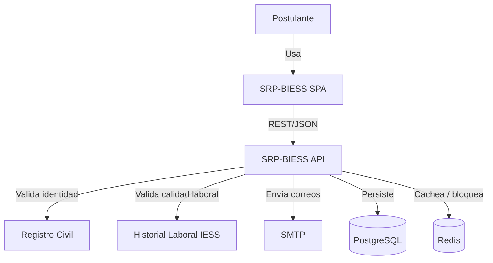
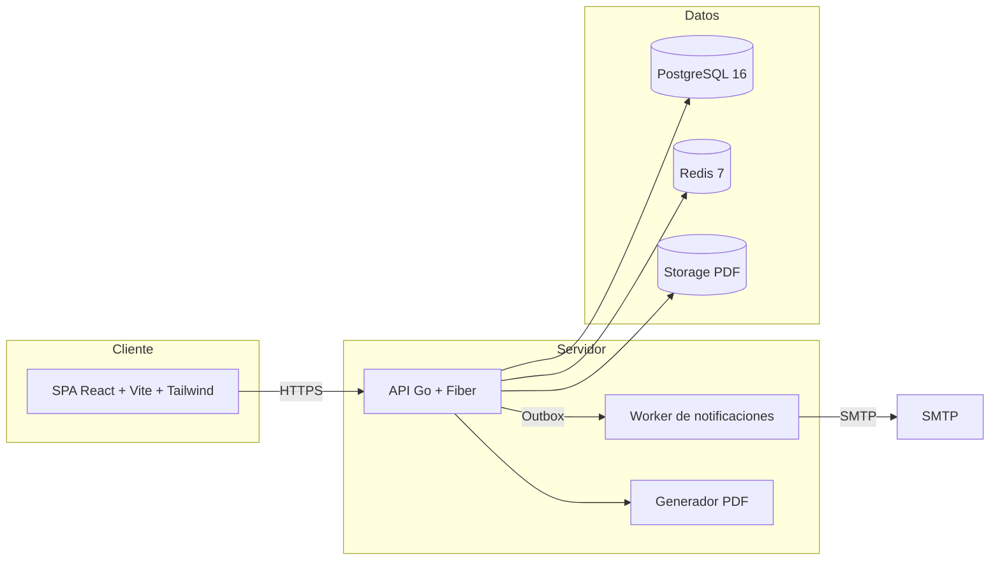
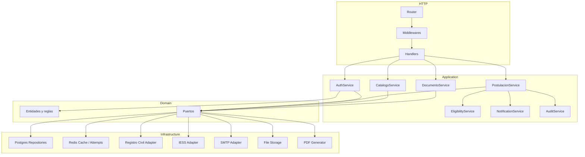
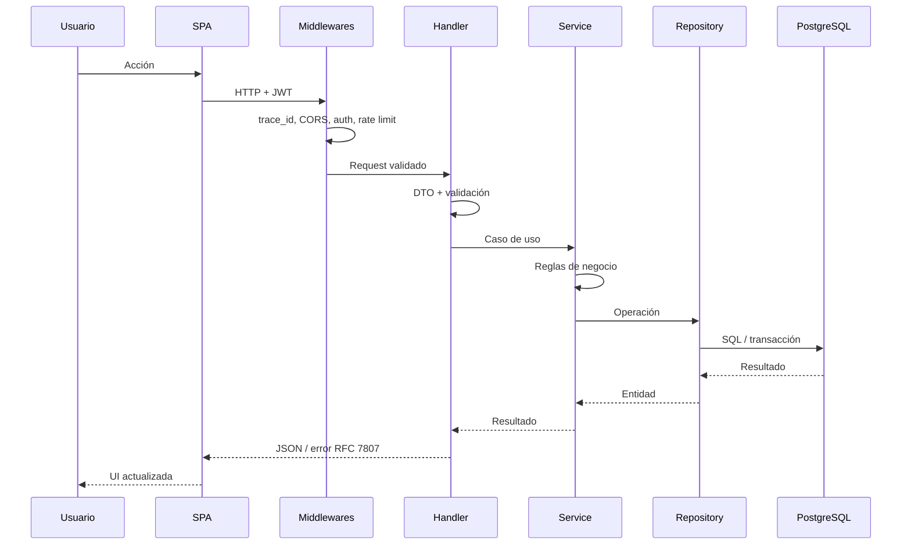

# 03. Arquitectura de software — SDD

## 3.1 Estilo arquitectónico

Se adopta un **microservicio transaccional con arquitectura interna en capas y puertos/adaptadores** (hexagonal-lite). El servicio es un único despliegue, pero su interior está desacoplado:

```text
┌─────────────────────────────────────────────────────────────┐
│                     SPA React + Vite                        │
└───────────────────────────┬─────────────────────────────────┘
                            │ REST/JSON
┌───────────────────────────▼─────────────────────────────────┐
│                     API Go + Fiber                          │
│  ┌──────────────┐  ┌──────────────┐  ┌──────────────────┐  │
│  │  Handlers    │→ │  Services    │→ │  Domain          │  │
│  │  (HTTP)      │  │  (Use Cases) │  │  (Entities)      │  │
│  └──────────────┘  └──────┬───────┘  └──────────────────┘  │
│                           │ ports                          │
│  ┌────────────────────────▼─────────────────────────────┐  │
│  │  Infrastructure: PostgreSQL, Redis, SMTP, Storage,   │  │
│  │  Registro Civil, IESS, PDF                           │  │
│  └──────────────────────────────────────────────────────┘  │
└─────────────────────────────────────────────────────────────┘
```

### ¿Por qué no microservicios distribuidos?

| Alternativa | Ventaja | Desventaja para el parcial |
|---|---|---|
| Microservicios separados (auth, postulación, catálogos) | Escalado independiente. | Complejidad de red, despliegue, transacciones distribuidas y observabilidad. |
| Monolito sin capas | Rápido de escribir. | No cumple separación de responsabilidades ni DI. |
| **Microservicio modular en capas** | Desacoplamiento, DI, transacciones locales, despliegue simple. | Requiere disciplina de límites internos. |

La opción elegida cumple la rúbrica, permite defender la arquitectura y deja preparada la extracción de módulos.

---

## 3.2 Diagramas C4

### 3.2.1 Contexto



### 3.2.2 Contenedores



### 3.2.3 Componentes del backend



---

## 3.3 Capas y regla de dependencia

| Capa | Responsabilidad | No debe |
|---|---|---|
| **Presentación (HTTP)** | Parsear request, validar DTO, autenticar, serializar respuesta. | Contener SQL ni reglas de negocio. |
| **Aplicación** | Orquestar casos de uso, transacciones, autorización, auditoría. | Conocer Fiber o pgx directamente. |
| **Dominio** | Entidades, value objects, reglas, cálculos, estados. | Importar infraestructura. |
| **Infraestructura** | Implementar puertos: PostgreSQL, Redis, SMTP, storage, integraciones. | Contener reglas de negocio. |

### Regla

```text
Presentation → Application → Domain
                     ↑
              Infrastructure (implementa puertos)
```

- El dominio no importa nada de las otras capas.
- La aplicación depende de interfaces del dominio.
- La infraestructura implementa esas interfaces.
- `main.go` es el **composition root**: construye y conecta todo.

---

## 3.4 Estructura de paquetes del backend

```text
backend/
├── cmd/
│   └── api/
│       └── main.go                 # composition root
├── internal/
│   ├── config/                     # variables de entorno
│   ├── domain/
│   │   ├── postulante/
│   │   ├── postulacion/
│   │   ├── catalogo/
│   │   ├── documento/
│   │   ├── inhabilidad/
│   │   └── shared/                 # errores, value objects, fechas
│   ├── application/
│   │   ├── auth/
│   │   ├── postulacion/
│   │   ├── catalogo/
│   │   ├── documento/
│   │   ├── elegibilidad/
│   │   ├── notificacion/
│   │   └── auditoria/
│   ├── infrastructure/
│   │   ├── persistence/postgres/
│   │   ├── cache/redis/
│   │   ├── integrations/registrocivil/
│   │   ├── integrations/iess/
│   │   ├── storage/
│   │   ├── mail/
│   │   └── pdf/
│   ├── interfaces/http/
│   │   ├── handler/
│   │   ├── middleware/
│   │   ├── dto/
│   │   └── router/
│   └── platform/
│       ├── logger/
│       ├── validator/
│       ├── security/
│       └── transaction/
├── migrations/
├── seeds/
├── tests/
├── Dockerfile
├── go.mod
└── .env.example
```

### Justificación

- `domain` contiene las reglas puras y las interfaces.
- `application` contiene los casos de uso; es el lugar donde se decide qué transacción abrir.
- `infrastructure` contiene los detalles reemplazables.
- `interfaces/http` contiene los adaptadores de entrada.
- `platform` contiene utilidades transversales sin lógica de negocio.

---

## 3.5 Estructura del frontend

```text
frontend/
├── src/
│   ├── app/
│   │   ├── App.tsx
│   │   ├── router.tsx
│   │   └── providers.tsx
│   ├── features/
│   │   ├── auth/
│   │   ├── postulacion/
│   │   ├── catalogos/
│   │   └── documentos/
│   ├── components/
│   │   ├── ui/
│   │   └── layout/
│   ├── services/
│   │   └── api/
│   ├── store/
│   ├── schemas/
│   ├── hooks/
│   ├── utils/
│   └── styles/
├── public/
├── index.html
├── tailwind.config.ts
├── vite.config.ts
└── package.json
```

### Principios

- **Feature-first:** cada funcionalidad agrupa componentes, hooks, esquemas y servicios.
- **UI reutilizable:** botones, campos, alerts, modales y loaders en `components/ui`.
- **Estado separado:** TanStack Query para estado del servidor; Zustand para sesión/UI.
- **Contratos:** Zod define esquemas de formulario y tipos inferidos.

---

## 3.6 Ciclo de vida de una solicitud



### Orden de middlewares

1. `Recover` (captura panics).
2. `RequestID` (`trace_id`).
3. `Logger` (método, ruta, estado, latencia).
4. `CORS`.
5. `SecurityHeaders`.
6. `RateLimit`.
7. `Auth` (solo rutas protegidas).
8. `RequireRole` (cuando aplique).
9. Handler.

---

## 3.7 Manejo de errores

### Tipos

| Tipo | Uso | HTTP |
|---|---|---|
| `ValidationError` | DTO o campo inválido. | 422 |
| `BusinessError` | Regla de negocio incumplida. | 409 / 422 |
| `AuthError` | Credenciales o sesión. | 401 / 423 |
| `ForbiddenError` | Sin permiso o recurso ajeno. | 403 |
| `NotFoundError` | Recurso inexistente. | 404 |
| `ConflictError` | Estado o versión. | 409 |
| `ExternalError` | Integración no disponible. | 503 |
| `InternalError` | Error no esperado. | 500 |

### Formato RFC 7807

```json
{
  "type": "https://api.biess.gob.ec/errors/business",
  "title": "Regla de negocio incumplida",
  "status": 422,
  "code": "POS_NACIONALIDAD_NO_ECUATORIANA",
  "detail": "La postulación no puede continuar porque la nacionalidad no es ecuatoriana.",
  "instance": "/api/v1/postulaciones/550e.../informacion-personal",
  "traceId": "8f3c2a1e-...",
  "errors": []
}
```

### Reglas

- No exponer stack traces, SQL ni nombres de tablas.
- Los errores de validación incluyen `field` y `message`.
- Los errores técnicos se registran con `trace_id`.
- La UI mapea `code` a mensajes y acciones.

---

## 3.8 Concurrencia y transacciones

### Transacciones

- `TxManager.WithTx(ctx, fn)` abre `BEGIN`, ejecuta `fn` y hace `COMMIT` o `ROLLBACK`.
- Los repositorios reciben un `Querier` que puede ser `*pgxpool.Pool` o `pgx.Tx`.
- Las operaciones de envío, guardado de secciones y registro usan transacción.

### Concurrencia optimista

- La tabla `postulacion` tiene `version`.
- Cada actualización usa `WHERE id = $1 AND version = $2` y `version = version + 1`.
- Si `RowsAffected() == 0`, se devuelve `ConflictError` (HTTP 409).

### Idempotencia

- El envío acepta `Idempotency-Key`.
- Se guarda en Redis `srp:{env}:idem:submit:{postulacionId}` con TTL 24 h.
- Si la clave existe, se devuelve la respuesta almacenada.

### Bloqueos distribuidos

- Para el envío se usa `SET srp:{env}:lock:submit:{id} NX PX 10000`.
- Si no se obtiene, se responde 409 “envío en proceso”.

---

## 3.9 Configuración

Toda la configuración proviene de variables de entorno, validadas al inicio:

| Variable | Ejemplo | Obligatoria |
|---|---|---|
| `APP_ENV` | `development` | Sí |
| `HTTP_ADDR` | `:8080` | Sí |
| `DATABASE_URL` | `postgres://...` | Sí |
| `REDIS_ADDR` | `localhost:6379` | Sí |
| `REDIS_PASSWORD` | `***` | No |
| `JWT_PRIVATE_KEY` | PEM | Sí |
| `JWT_PUBLIC_KEY` | PEM | Sí |
| `JWT_ISSUER` | `srp-biess` | Sí |
| `ACCESS_TOKEN_TTL` | `15m` | Sí |
| `REFRESH_TOKEN_TTL` | `8h` | Sí |
| `REGISTRO_CIVIL_URL` | `https://...` | Sí |
| `REGISTRO_CIVIL_MODE` | `mock` / `http` | Sí |
| `IESS_URL` | `https://...` | Sí |
| `IESS_MODE` | `mock` / `http` | Sí |
| `SMTP_HOST` | `mailpit` | Sí |
| `SMTP_PORT` | `1025` | Sí |
| `SMTP_FROM` | `no-reply@...` | Sí |
| `STORAGE_MODE` | `local` / `s3` | Sí |
| `STORAGE_PATH` | `./storage` | Sí |
| `MAX_TOTAL_UPLOAD_MB` | `50` | Sí |
| `CORS_ORIGINS` | `http://localhost:5173` | Sí |

---

## 3.10 Stack tecnológico

| Componente | Tecnología | Versión | Motivo |
|---|---|---|---|
| Backend | Go | 1.23+ | Rendimiento, concurrencia, tipado. |
| HTTP | Fiber | v2 | Middleware, rendimiento, simplicidad. |
| DB driver | pgx | v5 | Pool, transacciones, rendimiento. |
| Migraciones | golang-migrate | — | Versionado de esquema. |
| Validación | go-playground/validator | — | Validación declarativa de DTO. |
| JWT | golang-jwt | v5 | Tokens firmados. |
| Hash | `x/crypto/argon2` | — | Argon2id. |
| Logs | `log/slog` o zerolog | — | Logs estructurados. |
| Frontend | React | 18/19 | SPA modular. |
| Bundler | Vite | 5+ | Rapidez de desarrollo. |
| Estilos | Tailwind CSS | 3+ | Utilidades y responsive. |
| Estado servidor | TanStack Query | v5 | Caché, loading, errores. |
| Estado UI | Zustand | — | Sesión y estado global simple. |
| Formularios | React Hook Form | — | Performance y validación. |
| Esquemas | Zod | — | Validación y tipos. |
| HTTP cliente | Axios | — | Interceptores y manejo de errores. |
| DB | PostgreSQL | 16 | Relacional, transacciones, JSONB. |
| Caché | Redis | 7 | TTL, contadores, locks. |
| Correo | Mailpit / SMTP | — | Desarrollo y producción. |
| Contenedores | Docker Compose | — | Entorno reproducible. |

---

## 3.11 Decisiones de arquitectura

| ADR | Decisión | Capítulo |
|---|---|---|
| ADR-001 | Microservicio modular único. | `14` |
| ADR-002 | Fiber v2. | `14` |
| ADR-003 | DI manual. | `14` |
| ADR-004 | pgx + TxManager. | `14` |
| ADR-005 | Redis cache-aside. | `14` |
| ADR-006 | JWT + refresh cookie. | `14` |
| ADR-007 | TanStack Query + Zustand. | `14` |
| ADR-008 | RHF + Zod. | `14` |
| ADR-009 | Storage abstracto. | `14` |
| ADR-010 | Adaptadores mock. | `14` |
| ADR-011 | Outbox de notificaciones. | `14` |
| ADR-012 | PDF en servidor. | `14` |

---

## 3.12 Alineación con la rúbrica

| Criterio | Evidencia |
|---|---|
| Arquitectura en capas e DI | Secciones 3.3–3.5; `05`; `14`. |
| Persistencia y transacciones | `04`; `10`; `16`. |
| Redis | `04`; `09`; `10`. |
| SPA | `06`; `08`. |
| API y rutas protegidas | `06`; `07`; `09`. |
| Reglas de negocio | `05`; `09`; `10`; SRS `03` y `07`. |

