# 04. Diseño de datos — SDD

## 4.1 Principios

1. **Relacional y normalizado:** modelo en tercera forma normal (3NF) para evitar duplicidad y anomalías.
2. **Integridad declarativa:** claves primarias, foráneas, `UNIQUE`, `CHECK` y `NOT NULL` en la base.
3. **Transacciones:** toda operación multi-tabla se ejecuta dentro de una transacción.
4. **Auditoría:** los cambios relevantes se registran en una tabla append-only.
5. **Identificadores:** UUID para entidades de negocio; `bigserial` para auditoría y catálogos.
6. **Fechas:** `timestamptz` en UTC; la aplicación presenta `America/Guayaquil`.
7. **Borrado:** los borradores pueden eliminarse; las postulaciones enviadas son inmutables.
8. **Datos sensibles:** se minimizan, se cifran en tránsito y se controlan por permisos.

---

## 4.2 Modelo entidad-relación

```mermaid
erDiagram
  PAIS ||--o{ PROVINCIA : contiene
  PROVINCIA ||--o{ CANTON : contiene
  PAIS ||--o{ POSTULANTE : nacionalidad
  PAIS ||--o{ DOMICILIO_POSTULANTE : ubicacion
  PROVINCIA ||--o{ DOMICILIO_POSTULANTE : ubica
  CANTON ||--o{ DOMICILIO_POSTULANTE : ubica
  POSTULANTE ||--o| PAREJA_POSTULANTE : tiene
  POSTULANTE ||--o| DOMICILIO_POSTULANTE : registra
  POSTULANTE ||--o{ FAMILIAR_INSTITUCION : declara
  POSTULANTE ||--o{ POSTULACION : presenta
  CONVOCATORIA ||--o{ POSTULACION : agrupa
  CARGO ||--o{ POSTULACION : corresponde
  POSTULACION ||--o| RESPALDO_ORGANIZACIONAL : respalda
  POSTULACION ||--o{ FORMACION_ACADEMICA : incluye
  POSTULACION ||--o{ EXPERIENCIA_PROFESIONAL : incluye
  POSTULACION ||--o{ PUBLICACION : incluye
  POSTULACION ||--o{ CAPACITACION : incluye
  POSTULACION ||--o{ INHABILIDAD_RESPUESTA : responde
  INHABILIDAD_PREGUNTA ||--o{ INHABILIDAD_RESPUESTA : evalua
  POSTULACION ||--o{ DOCUMENTO : adjunta
  POSTULACION ||--o| CONSENTIMIENTO : acepta
  POSTULACION ||--o{ NOTIFICACION : genera
  POSTULANTE ||--o{ AUDITORIA_EVENTO : actor
```



---

## 4.3 Enumeraciones

| Enum | Valores |
|---|---|
| `estado_postulante` | `REGISTRADO`, `ACTIVO`, `BLOQUEADO`, `INACTIVO` |
| `estado_postulacion` | `BORRADOR`, `LISTA_PARA_ENVIO`, `ENVIADA`, `EN_REVISION`, `NO_ELEGIBLE`, `CERRADA` |
| `genero` | `MASCULINO`, `FEMENINO`, `OTRO`, `PREFIERO_NO_DECIR` |
| `estado_civil` | `SOLTERO`, `CASADO`, `UNION_DE_HECHO`, `DIVORCIADO`, `VIUDO`, `OTRO` |
| `sector_cargo` | `AFILIADOS`, `JUBILADOS`, `EMPLEADORES` |
| `nivel_instruccion` | `TERCER_NIVEL`, `ESPECIALIDAD`, `MAESTRIA`, `PHD` |
| `tipo_institucion` | `NACIONAL`, `EXTRANJERA` |
| `tipo_experiencia` | `GENERAL`, `DIRECCION` |
| `tipo_publicacion` | `PUBLICACION`, `TRABAJO_INVESTIGACION` |
| `tipo_evento` | `CURSO`, `SEMINARIO`, `TALLER` |
| `tipo_documento` | `RESPALDO_ORGANIZACIONAL`, `TITULO`, `EXPERIENCIA`, `PUBLICACION`, `CAPACITACION`, `FORMULARIO_POSTULACION` |
| `estado_documento` | `PENDIENTE`, `VALIDADO`, `RECHAZADO` |
| `estado_notificacion` | `PENDIENTE`, `ENVIADA`, `FALLIDA` |
| `efecto_inhabilidad` | `BLOQUEANTE`, `ALERTA`, `INFORMATIVO` |
| `institucion_familiar` | `IESS`, `BIESS` |
| `parentesco_familiar` | `CONVIVIENTE`, `CONYUGE`, `CUNADO`, `HERMANO`, `HIJO_POLITICO`, `HIJO`, `MADRE`, `NIETO`, `NUERA`, `PADRE`, `PRIMO_HERMANO`, `SOBRINO`, `SUEGRO`, `TIO`, `YERNO` |
| `tipo_validacion` | `FECHA_EXPEDICION`, `CODIGO_DACTILAR` |

---

## 4.4 Resumen de tablas

| Tabla | Propósito | Clave | Relaciones |
|---|---|---|---|
| `pais` | Catálogo de países. | `id` | Provincias, postulantes, domicilios. |
| `provincia` | Provincias por país. | `id` | Cantones, domicilios. |
| `canton` | Cantones por provincia. | `id` | Domicilios. |
| `cargo` | Cargos del concurso. | `id` | Postulaciones. |
| `convocatoria` | Proceso y fase. | `id` | Postulaciones. |
| `postulante` | Cuenta y datos verificados. | `id` | Pareja, domicilio, familiares, postulaciones. |
| `pareja_postulante` | Datos de pareja. | `id` | Postulante. |
| `domicilio_postulante` | Ubicación y contacto. | `id` | Postulante, país, provincia, cantón. |
| `familiar_institucion` | Familiares en IESS/BIESS. | `id` | Postulante. |
| `postulacion` | Expediente del postulante. | `id` | Postulante, convocatoria, cargo. |
| `respaldo_organizacional` | Respaldo y documento. | `id` | Postulación, documento. |
| `formacion_academica` | Títulos. | `id` | Postulación, documento. |
| `experiencia_profesional` | Trayectoria. | `id` | Postulación, documento. |
| `publicacion` | Producción académica. | `id` | Postulación, documento. |
| `capacitacion` | Cursos y eventos. | `id` | Postulación, documento. |
| `inhabilidad_pregunta` | Catálogo de preguntas. | `id` | Respuestas. |
| `inhabilidad_respuesta` | Respuestas del postulante. | `id` | Postulación, pregunta. |
| `documento` | Metadatos de PDF. | `id` | Postulante, postulación. |
| `consentimiento` | Aceptación informada. | `id` | Postulación. |
| `notificacion` | Outbox de correos. | `id` | Postulación, postulante. |
| `auditoria_evento` | Evidencia append-only. | `id` | Actor, entidad. |

---

## 4.5 Diccionario de tablas principales

### 4.5.1 `postulante`

| Columna | Tipo | Restricciones | Descripción |
|---|---|---|---|
| `id` | `uuid` | PK, default `gen_random_uuid()` | Identificador. |
| `cedula` | `char(10)` | `UNIQUE`, `NOT NULL` | Cédula validada. |
| `nombres` | `varchar(150)` | `NOT NULL` | Nombres verificados. |
| `apellidos` | `varchar(150)` | `NOT NULL` | Apellidos verificados. |
| `genero` | `genero` | `NOT NULL` | Género. |
| `fecha_nacimiento` | `date` | `NOT NULL` | Fecha de nacimiento. |
| `nacionalidad_pais_id` | `smallint` | FK `pais(id)`, `NOT NULL` | Nacionalidad. |
| `estado_civil` | `estado_civil` | — | Se completa en la sección de información personal de EF-12. |
| `correo` | `varchar(254)` | `UNIQUE` (case-insensitive), `NOT NULL` | Correo de acceso. |
| `password_hash` | `varchar(255)` | `NOT NULL` | Hash Argon2id. |
| `estado` | `estado_postulante` | `NOT NULL DEFAULT 'ACTIVO'` | Estado de la cuenta. |
| `fecha_registro` | `timestamptz` | `NOT NULL DEFAULT now()` | Alta. |
| `ultimo_acceso` | `timestamptz` | — | Último login. |
| `version` | `integer` | `NOT NULL DEFAULT 1` | Concurrencia optimista. |

### 4.5.2 `postulacion`

| Columna | Tipo | Restricciones | Descripción |
|---|---|---|---|
| `id` | `uuid` | PK | Identificador. |
| `codigo_unico` | `varchar(30)` | `UNIQUE`, nullable | Código al enviar. |
| `postulante_id` | `uuid` | FK `postulante(id)` | Dueño. |
| `convocatoria_id` | `integer` | FK `convocatoria(id)` | Proceso. |
| `cargo_id` | `smallint` | FK `cargo(id)` | Cargo. |
| `estado` | `estado_postulacion` | `NOT NULL DEFAULT 'BORRADOR'` | Estado. |
| `fecha_creacion` | `timestamptz` | `NOT NULL DEFAULT now()` | Alta. |
| `fecha_guardado` | `timestamptz` | — | Último guardado. |
| `fecha_envio` | `timestamptz` | — | Envío. |
| `elegibilidad_estado` | `varchar(20)` | `NOT NULL DEFAULT 'PENDIENTE'` | `PENDIENTE`, `ELEGIBLE`, `NO_ELEGIBLE`, `INDETERMINADO`. |
| `elegibilidad_motivo` | `text` | — | Detalle. |
| `requiere_revision` | `boolean` | `NOT NULL DEFAULT false` | Alerta de inhabilidades. |
| `tiene_familiares_institucion` | `boolean` | — | `NULL` = no respondido; declaración explícita Sí/No. |
| `tiene_publicaciones` | `boolean` | — | `NULL` = no respondido; declaración explícita Sí/No. |
| `ultima_seccion` | `varchar(40)` | — | Sección para reanudar el borrador. |
| `version` | `integer` | `NOT NULL DEFAULT 1` | Concurrencia. |

> `tiene_familiares_institucion` y `tiene_publicaciones` permiten distinguir una declaración negativa explícita de una sección aún no respondida. Ambos son `NULL` hasta que el postulante guarda la sección.

### 4.5.3 `documento`

| Columna | Tipo | Restricciones | Descripción |
|---|---|---|---|
| `id` | `uuid` | PK | Identificador. |
| `postulante_id` | `uuid` | FK | Dueño. |
| `postulacion_id` | `uuid` | FK, nullable | Postulación. |
| `tipo` | `tipo_documento` | `NOT NULL` | Tipo. |
| `nombre_original` | `varchar(255)` | `NOT NULL` | Nombre visible. |
| `nombre_almacenado` | `varchar(255)` | `UNIQUE` | UUID + `.pdf`. |
| `mime_type` | `varchar(100)` | `NOT NULL` | `application/pdf`. |
| `tamano_bytes` | `bigint` | `NOT NULL` | Tamaño. |
| `hash_sha256` | `char(64)` | `NOT NULL` | Integridad. |
| `ruta` | `text` | `NOT NULL` | Ruta privada. |
| `estado` | `estado_documento` | `NOT NULL` | Estado. |
| `created_at` | `timestamptz` | `NOT NULL` | Alta. |

### 4.5.4 `inhabilidad_pregunta`

| Columna | Tipo | Restricciones | Descripción |
|---|---|---|---|
| `id` | `smallserial` | PK | Identificador. |
| `codigo` | `varchar(20)` | `UNIQUE` | Ej. `1.9.1`. |
| `texto` | `text` | `NOT NULL` | Pregunta. |
| `orden` | `smallint` | `NOT NULL` | Orden. |
| `efecto` | `efecto_inhabilidad` | `NOT NULL` | Efecto. |
| `respuesta_bloqueante` | `boolean` | — | Respuesta binaria que activa el efecto `BLOQUEANTE`; `NULL` en preguntas de alerta. |
| `activo` | `boolean` | `NOT NULL DEFAULT true` | Vigencia. |

### 4.5.5 `auditoria_evento`

| Columna | Tipo | Restricciones | Descripción |
|---|---|---|---|
| `id` | `bigserial` | PK | Secuencia. |
| `actor_id` | `uuid` | nullable | Usuario o sistema. |
| `actor_tipo` | `varchar(20)` | `NOT NULL` | `POSTULANTE`, `SISTEMA`, `ADMIN`. |
| `accion` | `varchar(80)` | `NOT NULL` | Evento. |
| `entidad` | `varchar(80)` | `NOT NULL` | Tabla o recurso. |
| `entidad_id` | `varchar(64)` | — | ID afectado. |
| `datos_antes` | `jsonb` | — | Estado previo. |
| `datos_despues` | `jsonb` | — | Estado nuevo. |
| `ip` | `inet` | — | Origen. |
| `user_agent` | `text` | — | Navegador. |
| `trace_id` | `uuid` | — | Correlación. |
| `created_at` | `timestamptz` | `NOT NULL` | Fecha. |

---

## 4.6 Tablas secundarias

### 4.6.1 Catálogos geográficos

| Tabla | Columnas principales |
|---|---|
| `pais` | `id`, `codigo_iso2`, `codigo_iso3`, `nombre`, `activo` |
| `provincia` | `id`, `pais_id`, `codigo`, `nombre`, `activo`; único `(pais_id, codigo)` |
| `canton` | `id`, `provincia_id`, `codigo`, `nombre`, `activo`; único `(provincia_id, codigo)` |

### 4.6.2 Convocatoria y cargo

| Tabla | Columnas principales |
|---|---|
| `convocatoria` | `id`, `codigo`, `nombre`, `fecha_inicio_postulacion`, `fecha_fin_postulacion`, `fase_postulacion_habilitada`, `version_formulario` |
| `cargo` | `id`, `codigo` (`AFI`, `JUB`, `EMP`), `nombre`, `sector`, `activo` |

### 4.6.3 Datos personales y domicilio

| Tabla | Columnas principales |
|---|---|
| `pareja_postulante` | `id`, `postulante_id` (único), `nombres_apellidos`, `cedula` |
| `domicilio_postulante` | `id`, `postulante_id` (único), `pais_id`, `provincia_id`, `canton_id`, `provincia_manual`, `ciudad_manual`, `telefono_celular`, `correo_alterno`, `calle_principal`, `numero`, `calle_secundaria`, `sector`, `referencia`, `telefono_domicilio` |
| `familiar_institucion` | `id`, `postulante_id`, `nombres_apellidos`, `parentesco`, `institucion`, `area`, `cargo` |

### 4.6.4 Secciones de la postulación

| Tabla | Columnas principales |
|---|---|
| `respaldo_organizacional` | `id`, `postulacion_id` (único), `tiene_respaldo`, `nombre_organizacion`, `documento_id` |
| `formacion_academica` | `id`, `postulacion_id`, `nivel_instruccion`, `institucion_educativa`, `tipo_institucion`, `titulo_obtenido`, `area_estudios`, `numero_registro_senescyt`, `fecha_registro_senescyt`, `documento_id` |
| `experiencia_profesional` | `id`, `postulacion_id`, `tipo_experiencia`, `cargo_puesto`, `institucion_empresa`, `fecha_inicio`, `fecha_fin`, `actualmente`, `actividades_relacionadas`, `descripcion_funciones`, `tiempo_anios`, `tiempo_meses`, `tiempo_dias`, `documento_id` |
| `publicacion` | `id`, `postulacion_id`, `titulo`, `tipo`, `medio_publicacion`, `fecha_publicacion`, `relacion_formacion`, `documento_id` |
| `capacitacion` | `id`, `postulacion_id`, `tipo_evento`, `nombre_evento`, `institucion`, `fecha_inicio`, `fecha_fin`, `numero_horas`, `documento_id` |
| `inhabilidad_respuesta` | `id`, `postulacion_id`, `pregunta_id`, `respuesta`, `efecto_calculado`, `institucion_remocion`, `cargo_remocion`, `fecha_fin_remocion`, `motivo_remocion`; único `(postulacion_id, pregunta_id)` |

### 4.6.5 Consentimiento y notificación

| Tabla | Columnas principales |
|---|---|
| `consentimiento` | `id`, `postulacion_id` (único), `version_terminos`, `aceptado`, `textos_aceptados` (JSONB), `fecha_aceptacion`, `ip`, `user_agent` |
| `notificacion` | `id`, `postulacion_id`, `postulante_id`, `tipo`, `destinatario`, `asunto`, `plantilla`, `payload` (JSONB), `estado`, `intentos`, `fecha_creacion`, `proximo_intento`, `fecha_envio`, `error` |

### 4.6.6 Pagos y facturación electrónica (ADR-014)

| Tabla | Columnas principales |
|---|---|
| `transaccion_pago` | `id`, `postulacion_id`, `postulante_id`, `codigo_transaccion`, `monto`, `moneda`, `franquicia`, `ultimos_cuatro`, `estado` (`PENDIENTE`, `APROBADO`, `RECHAZADO`, `REVERTIDO`), `gateway_provider` (`MOCK`, `KUSHKI`, `STRIPE`), `autorizacion_codigo`, `fecha_transaccion`, `error_mensaje` |
| `factura` | `id`, `transaccion_pago_id` (único), `postulacion_id`, `numero_factura`, `clave_acceso_sri` (49 dígitos), `subtotal`, `iva`, `total`, `estado` (`EMITIDA`, `ANULADA`, `FALLIDA`), `enviada_correo`, `documento_pdf_id`, `xml_autorizado`, `created_at` |

---

## 4.7 Relaciones y cardinalidad

| Relación | Cardinalidad | Regla |
|---|---|---|
| País → Provincias | 1:N | Una provincia pertenece a un país. |
| Provincia → Cantones | 1:N | Un cantón pertenece a una provincia. |
| Postulante → Pareja | 1:0..1 | Solo si estado civil lo requiere. |
| Postulante → Domicilio | 1:1 | Un domicilio vigente. |
| Postulante → Familiares | 1:N | Cero o más. |
| Postulante → Postulación | 1:N histórica | Una vigente por convocatoria. |
| Convocatoria → Postulación | 1:N | Agrupa postulaciones. |
| Cargo → Postulación | 1:N | Un cargo por postulación. |
| Postulación → Formación | 1:N | Al menos una para enviar. |
| Postulación → Experiencia | 1:N | Cero o más. |
| Postulación → Publicación | 1:N | Cero o más. |
| Postulación → Capacitación | 1:N | Cero o más. |
| Postulación → Inhabilidad | 1:N | Exactamente 13 al enviar. |
| Postulación → Documento | 1:N | Según sección. |
| Postulación → Consentimiento | 1:1 | Obligatorio al enviar. |

---

## 4.8 Índices y restricciones

### Índices recomendados

```sql
CREATE UNIQUE INDEX uq_postulante_cedula ON postulante (cedula);
CREATE UNIQUE INDEX uq_postulante_correo ON postulante (correo);
CREATE UNIQUE INDEX uq_postulacion_codigo ON postulacion (codigo_unico)
  WHERE codigo_unico IS NOT NULL;
CREATE UNIQUE INDEX uq_postulacion_vigente
  ON postulacion (postulante_id, convocatoria_id)
  WHERE estado <> 'CERRADA';
CREATE INDEX idx_postulacion_postulante ON postulacion (postulante_id);
CREATE INDEX idx_postulacion_estado ON postulacion (estado);
CREATE INDEX idx_documento_postulacion ON documento (postulacion_id, tipo);
CREATE INDEX idx_experiencia_postulacion ON experiencia_profesional (postulacion_id);
CREATE INDEX idx_auditoria_entidad ON auditoria_evento (entidad, entidad_id, created_at DESC);
CREATE INDEX idx_canton_provincia ON canton (provincia_id);
CREATE INDEX idx_provincia_pais ON provincia (pais_id);
```

### Restricciones clave

- `CHECK (fecha_fin IS NULL OR fecha_fin >= fecha_inicio)` en experiencia; `CHECK (fecha_fin >= fecha_inicio)` en capacitación.
- `CHECK (numero_horas > 0)` en capacitación.
- `CHECK (tamano_bytes > 0)` y límites por tipo en `documento`: 4 MB para respaldo y 2 MB para los demás PDF de postulación.
- `CHECK (codigo_unico IS NULL OR estado IN ('ENVIADA','EN_REVISION','NO_ELEGIBLE','CERRADA'))` para evitar códigos en borradores.
- `CHECK (estado NOT IN ('ENVIADA','EN_REVISION') OR codigo_unico IS NOT NULL)` para exigir código al enviar.
- `UNIQUE (postulacion_id, pregunta_id)` en inhabilidades.
- `UNIQUE (postulacion_id)` en consentimiento y respaldo.
- `CHECK (actualmente = true AND fecha_fin IS NULL) OR (actualmente = false AND fecha_fin IS NOT NULL)` en experiencia.
- `CHECK (tiene_respaldo = false ... ) OR (tiene_respaldo = true AND nombre_organizacion IS NOT NULL)` en respaldo.

---

## 4.9 Diseño de Redis

### 4.9.1 Convención de claves

```text
srp:{env}:{dominio}:{recurso}:{id}:{version}
```

Ejemplo: `srp:prod:cat:provincias:1:v1`.

### 4.9.2 Claves

| Clave | Tipo | TTL | Uso |
|---|---|---|---|
| `srp:{env}:cat:paises:{v}` | String (JSON) | 24 h + jitter | Catálogo de países. |
| `srp:{env}:cat:provincias:{paisId}:{v}` | String (JSON) | 24 h + jitter | Provincias. |
| `srp:{env}:cat:cantones:{provId}:{v}` | String (JSON) | 24 h + jitter | Cantones. |
| `srp:{env}:cat:version` | String | Sin TTL | Versión global de catálogo. |
| `srp:{env}:auth:reg:attempts:{cedula}` | String (contador) | 600 s | Intentos de registro. |
| `srp:{env}:auth:reg:lock:{cedula}` | String | 600 s | Bloqueo de registro. |
| `srp:{env}:auth:login:attempts:{cedula}` | String | 600 s | Intentos de login. |
| `srp:{env}:auth:login:lock:{cedula}` | String | 600 s | Bloqueo de login. |
| `srp:{env}:auth:refresh:{jti}` | String (hash) | 8 h | Refresh token. |
| `srp:{env}:auth:reset:{hash}` | String | 30 min | Recuperación. |
| `srp:{env}:auth:denylist:{jti}` | String | TTL restante | Revocación de access token. |
| `srp:{env}:rl:{scope}:{id}` | String | 60 s | Rate limiting. |
| `srp:{env}:idem:submit:{postulacionId}` | String (JSON) | 24 h | Idempotencia de envío. |
| `srp:{env}:lock:submit:{postulacionId}` | String | 10 s | Lock distribuido. |

### 4.9.3 Estrategia

- **Caché:** `allkeys-lru` en DB 0.
- **Seguridad:** `noeviction` en DB 1 para no perder contadores.
- **Atomicidad:** script Lua para incrementar intentos y crear bloqueo en una sola operación.
- **Invalidación:** incrementar `cat:version`; las claves nuevas usan la versión.
- **Jitter:** TTL de 24 h ± 5 min para evitar expiración masiva.
- **Fallback:** si Redis falla, catálogos desde PostgreSQL; autenticación fail-closed.

### 4.9.4 Script Lua de intentos

```lua
local key = KEYS[1]
local lock = KEYS[2]
local maxAttempts = tonumber(ARGV[1])
local ttl = tonumber(ARGV[2])
local current = redis.call('INCR', key)
if current == 1 then
  redis.call('EXPIRE', key, ttl)
end
if current >= maxAttempts then
  redis.call('SET', lock, '1', 'EX', ttl)
  return {current, 1, ttl}
end
return {current, 0, redis.call('TTL', key)}
```

---

## 4.10 Transacciones

| Operación | Tablas | Estrategia |
|---|---|---|
| Registro | `postulante`, `auditoria_evento` | `BEGIN` → insert → audit → `COMMIT`. |
| Guardar información personal | `postulante`, `pareja_postulante`, `postulacion` | `BEGIN` → upsert → audit → `COMMIT`. |
| Guardar domicilio | `domicilio_postulante`, `postulacion` | `BEGIN` → upsert → audit → `COMMIT`. |
| Guardar ítem repetible | tabla hija, `documento`, `postulacion` | `BEGIN` → validar → insert/update → audit → `COMMIT`. |
| Enviar postulación | `postulacion`, `consentimiento`, `documento`, `notificacion`, `auditoria_evento` | `BEGIN` → `SELECT ... FOR UPDATE` → validar → código → estado → PDF → documento → outbox → audit → `COMMIT`. |
| Cargar documento | `documento`, `postulacion` | Guardar archivo → `BEGIN` → insert → audit → `COMMIT`; si falla DB, borrar archivo. |

### Regla de oro

> Ninguna operación de negocio que afecte más de una tabla se ejecuta fuera de una transacción.

---

## 4.11 Almacenamiento de archivos

```text
storage/
└── {postulanteId}/
    └── {postulacionId}/
        ├── {uuid}.pdf          # respaldo
        └── formulario-{codigo}.pdf
```

- El nombre original se guarda solo en la base.
- La ruta no se expone directamente.
- La descarga usa URL firmada con TTL de 5 min.
- El hash SHA-256 permite verificar integridad.
- El total por postulante se calcula con `SUM(tamano_bytes)`.

---

## 4.12 Auditoría y retención

- `auditoria_evento` es append-only: sin `UPDATE` ni `DELETE` para el usuario de aplicación.
- Se particiona por año si el volumen lo requiere.
- Los datos sensibles se redactan en `datos_antes`/`datos_despues` (por ejemplo, no se guarda la contraseña).
- Retención propuesta: 7 años para auditoría; 5 años para postulaciones; 90 días para logs.
- Los borradores abandonados se pueden purgar a los 90 días.

---

## 4.13 Datos semilla

| Catálogo | Origen | Estrategia |
|---|---|---|
| Países | Lista del RF v1.4 | `INSERT ... ON CONFLICT DO NOTHING`. |
| Provincias | 24 provincias de Ecuador | Seed idempotente. |
| Cantones | Lista del RF v1.4 | Seed idempotente por provincia. |
| Cargos | AFI, JUB, EMP | Seed fijo. |
| Preguntas de inhabilidades | RF v1.4, 1.9.1–1.9.13 | Seed con `codigo`, `texto`, `orden`, `efecto`. |
| Convocatoria | Datos de prueba | Seed de desarrollo. |

---

## 4.14 Volumen y crecimiento

| Tabla | Filas estimadas | Crecimiento |
|---|---|---|
| `postulante` | 1 000 | Por convocatoria. |
| `postulacion` | 1 000 | Por convocatoria. |
| `documento` | 5 000 | 5–10 por postulación. |
| `formacion_academica` | 3 000 | 1–5 por postulación. |
| `experiencia_profesional` | 5 000 | 1–10 por postulación. |
| `auditoria_evento` | 50 000+ | Continuo. |
| `pais` / `provincia` / `canton` | ~250 / 24 / ~220 | Bajo. |

El diseño soporta el volumen del piloto y permite particionar auditoría y archivar postulaciones cerradas.

