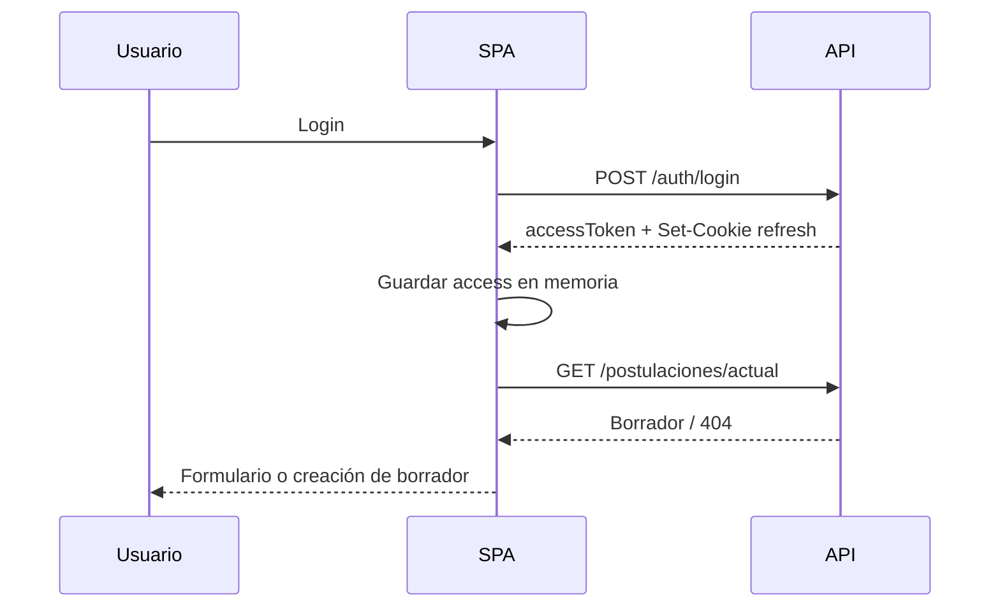

# 06. Diseño de componentes frontend — SDD

## 6.1 Arquitectura de la SPA

La SPA se organiza por **funcionalidades** (`features`), con componentes de UI reutilizables y una capa de servicios que encapsula la API.

```text
src/
├── app/
│   ├── App.tsx
│   ├── router.tsx
│   └── providers.tsx
├── features/
│   ├── auth/
│   │   ├── components/
│   │   ├── hooks/
│   │   ├── pages/
│   │   └── schemas/
│   ├── postulacion/
│   │   ├── components/
│   │   ├── hooks/
│   │   ├── pages/
│   │   ├── sections/
│   │   └── schemas/
│   ├── catalogos/
│   └── documentos/
├── components/
│   ├── ui/
│   └── layout/
├── services/
│   ├── api/
│   ├── auth/
│   └── catalogos/
├── store/
├── hooks/
├── utils/
└── styles/
```

### Principios

- Una página compone componentes; no contiene lógica de API directamente.
- Los hooks encapsulan queries/mutations.
- Los esquemas Zod son la fuente de tipos de formulario.
- Los componentes de UI no conocen reglas de negocio.

---

## 6.2 Rutas

| Ruta | Componente | Protegida | Propósito |
|---|---|---|---|
| `/` | `LandingPage` | No | Bienvenida y acceso. |
| `/login` | `LoginPage` | No | Inicio de sesión. |
| `/registro` | `RegisterPage` | No | Validación de identidad y credenciales. |
| `/registro/bloqueado` | `RegisterLockedPage` | No | Bloqueo temporal. |
| `/recuperar-password` | `ForgotPasswordPage` | No | Solicitud de recuperación. |
| `/restablecer-password` | `ResetPasswordPage` | No | Nueva contraseña. |
| `/postulacion` | `PostulacionLayout` | Sí | Layout con stepper. |
| `/postulacion/personal` | `PersonalInfoPage` | Sí | Información personal. |
| `/postulacion/domicilio` | `DomicilioPage` | Sí | Domicilio y contacto. |
| `/postulacion/familiares` | `FamiliaresPage` | Sí | Información adicional. |
| `/postulacion/cargo` | `CargoPage` | Sí | Selección y elegibilidad. |
| `/postulacion/formacion` | `FormacionPage` | Sí | Formación académica. |
| `/postulacion/experiencia` | `ExperienciaPage` | Sí | Experiencia profesional. |
| `/postulacion/publicaciones` | `PublicacionesPage` | Sí | Publicaciones. |
| `/postulacion/capacitacion` | `CapacitacionPage` | Sí | Capacitación. |
| `/postulacion/inhabilidades` | `InhabilidadesPage` | Sí | Cuestionario legal. |
| `/postulacion/resumen` | `ResumenPage` | Sí | Revisión y consentimiento. |
| `/postulacion/enviada` | `EnviadaPage` | Sí | Confirmación y código. |
| `/mi-postulacion` | `MiPostulacionPage` | Sí | Estado y PDF. |
| `*` | `NotFoundPage` | No | 404. |

### Guards

- `ProtectedRoute`: verifica sesión; si no hay, redirige a `/login?redirect=...`.
- `GuestRoute`: si hay sesión, redirige a `/postulacion`.
- `PhaseGuard`: si la fase está cerrada, muestra aviso.
- `PostulacionGuard`: si no hay borrador, lo crea; si está enviada, redirige a `/mi-postulacion`.

---

## 6.3 Estado

| Tipo de estado | Herramienta | Ejemplo |
|---|---|---|
| Estado del servidor | TanStack Query | Postulación, catálogos, perfil. |
| Sesión | Zustand + memoria | Usuario, access token, expiración. |
| Estado de UI | Zustand local | Stepper, modales, toasts. |
| Estado de formulario | React Hook Form | Campos, errores, dirty. |
| Estado de URL | React Router | Sección actual, filtros. |

### Reglas

- El **access token** se guarda en memoria (no en `localStorage`).
- El **refresh token** vive en cookie `HttpOnly`, `Secure`, `SameSite=Strict`.
- Al recargar, se intenta `POST /auth/refresh`; si falla, se limpia la sesión.
- TanStack Query usa `staleTime` de 24 h para catálogos y `retry: 1`.

---

## 6.4 Formularios

### Stack

- **React Hook Form** para registro y rendimiento.
- **Zod** para esquemas y mensajes.
- **@hookform/resolvers** para integrar Zod.

### Patrón

```tsx
const schema = z.object({
  telefonoCelular: z.string().regex(/^(\+?593|0)9\d{8}$/, "Teléfono inválido"),
  correoAlterno: z.string().email("Correo inválido").optional(),
});

type FormValues = z.infer<typeof schema>;

const form = useForm<FormValues>({ resolver: zodResolver(schema), mode: "onBlur" });
```

### Reglas

- Validación al salir del campo y al enviar.
- Errores junto al campo y resumen al inicio.
- Botón “Guardar progreso” deshabilitado mientras guarda.
- Advertencia si hay cambios sin guardar.
- Los campos autocompletados se muestran como `readOnly`.
- Los formularios repetibles usan `useFieldArray` o un modal de ítem.

---

## 6.5 Catálogo de componentes

| Componente | Responsabilidad |
|---|---|
| `AppShell` | Layout general, header, footer, navegación. |
| `Stepper` | Progreso de secciones y navegación. |
| `TextField` | Input con label, error y ayuda. |
| `SelectField` | Select con opciones y error. |
| `DateField` | Fecha con formato `DD/MM/AAAA`. |
| `RadioGroup` | Sí/No y opciones excluyentes. |
| `CheckboxConsent` | Consentimientos legales. |
| `FileUpload` | Carga PDF con validación y progreso. |
| `DataTable` | Lista de ítems con editar/eliminar. |
| `ConfirmDialog` | Confirmación de acciones irreversibles. |
| `Alert` | Mensajes de éxito, error, advertencia e info. |
| `Toast` | Feedback no bloqueante. |
| `Loader` / `Skeleton` | Estados de carga. |
| `EmptyState` | Listas vacías. |
| `StatusBadge` | Estado de postulación. |
| `CascadingLocationSelect` | País → provincia → cantón. |
| `ExperienceCalculator` | Muestra años, meses y días. |
| `ConsentList` | Cinco consentimientos. |
| `PdfDownloadButton` | Descarga con URL firmada. |
| `ErrorBoundary` | Captura errores de render. |

---

## 6.6 Cliente API

```ts
const api = axios.create({
  baseURL: import.meta.env.VITE_API_URL,
  withCredentials: true,
  headers: { "Content-Type": "application/json" },
});

api.interceptors.request.use((config) => {
  const token = useAuthStore.getState().accessToken;
  if (token) config.headers.Authorization = `Bearer ${token}`;
  return config;
});

api.interceptors.response.use(
  (res) => res,
  async (error) => {
    const original = error.config;
    if (error.response?.status === 401 && !original._retry) {
      original._retry = true;
      const ok = await refreshSession();
      if (ok) return api(original);
      logout();
    }
    return Promise.reject(normalizeError(error));
  }
);
```

### Manejo de errores

- `normalizeError` convierte RFC 7807 en `{ code, message, fields, traceId }`.
- La UI muestra `message` y, si hay `fields`, los asocia a inputs.
- Los errores 423 muestran cuenta regresiva.
- Los errores 503 ofrecen reintento.

---

## 6.7 Flujo de autenticación



### Reglas

- No guardar tokens en `localStorage`.
- El refresh se intenta una sola vez por request.
- Al cerrar sesión, se llama `POST /auth/logout` y se limpia el estado.
- Si el refresh falla, se redirige al login con `redirect`.

---

## 6.8 Cascada geográfica

```tsx
const { data: paises } = useQuery({ queryKey: ["paises"], queryFn: getPaises, staleTime: 24h });
const { data: provincias } = useQuery({
  queryKey: ["provincias", paisId],
  queryFn: () => getProvincias(paisId),
  enabled: paisId === ECUADOR_ID,
});
```

- Al cambiar país, se limpian provincia y cantón.
- Para el extranjero, se habilitan inputs manuales.
- Los catálogos se cachean en TanStack Query y en Redis.
- Si falla la carga, se muestra reintento.

---

## 6.9 Carga de documentos

- Acepta solo `application/pdf`.
- Valida tamaño en cliente y servidor.
- Muestra progreso y nombre del archivo.
- Permite reemplazar o eliminar.
- Muestra el documento asociado a cada ítem.
- Si el total supera 50 MB, bloquea antes de subir.

```tsx
<FileUpload
  maxSizeMB={2}
  accept="application/pdf"
  onUpload={async (file) => uploadDocumento({ file, tipo: "TITULO" })}
/>
```

---

## 6.10 Calculadora de experiencia

- Se actualiza al cambiar `fechaInicio`, `fechaFin` o “Actualmente”.
- Muestra “3 años, 1 mes y 23 días”.
- Muestra advertencia si hay superposición.
- Muestra total acumulado referencial.
- No envía el cálculo al servidor como verdad; el servidor recalcula.

---

## 6.11 Estados de UI

| Estado | Comportamiento |
|---|---|
| **Loading** | Skeleton o spinner; botones deshabilitados. |
| **Success** | Toast o alerta; actualización de datos. |
| **Error de validación** | Errores por campo + resumen. |
| **Error de red** | Alerta con reintento. |
| **Sesión expirada** | Redirección al login. |
| **Postulación cerrada** | Modo lectura. |
| **Fase cerrada** | Aviso y bloqueo. |
| **Lista vacía** | Empty state con acción. |
| **Cambios sin guardar** | Confirmación al salir. |

---

## 6.12 Accesibilidad y responsive

- Etiquetas asociadas a inputs (`htmlFor`).
- `aria-invalid`, `aria-describedby` para errores.
- Foco visible y orden lógico.
- Contraste ≥ 4.5:1.
- Navegación completa por teclado.
- Botones con texto, no solo iconos.
- Mensajes de error anunciados con `role="alert"`.
- Breakpoints Tailwind: `sm`, `md`, `lg`, `xl`.
- Formulario de una columna en móvil; dos columnas en desktop.

---

## 6.13 Rendimiento

- Code splitting por ruta con `React.lazy`.
- Imágenes optimizadas y `loading="lazy"`.
- Evitar renderizados innecesarios con `memo` cuando se justifique.
- `staleTime` para catálogos.
- Paginación o listas virtualizadas si crecen.
- Bundle inicial < 300 KB gzip (objetivo).

---

## 6.14 Pruebas

| Tipo | Herramienta | Alcance |
|---|---|---|
| Unitarias | Vitest | Hooks, utils, schemas. |
| Componentes | React Testing Library | Formularios, validaciones, estados. |
| E2E | Playwright | Registro, postulación, envío. |
| Accesibilidad | axe | Flujos críticos. |

### Casos mínimos

- Validación de cédula y contraseña.
- Cascada país/provincia/cantón.
- Guardado de sección y reanudación.
- Bloqueo de nacionalidad.
- Carga de PDF inválido.
- Envío y descarga de PDF.
- Ruta protegida sin sesión.
