# 10. Diseño de procesos y transacciones — SDD

## 10.1 Propósito

Este capítulo describe los procesos críticos del módulo, sus secuencias, límites transaccionales, estados, idempotencia y compensaciones. Es la guía para implementar los casos de uso y para demostrar la atomicidad exigida por la rúbrica.

---

## 10.2 Registro de postulante

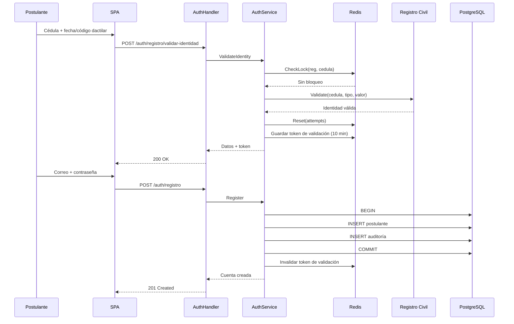

### Reglas

- La cuenta se crea solo con identidad validada.
- La cédula y el correo son únicos.
- La transacción incluye el alta y la auditoría.
- El token de validación se invalida al registrarse.
- No se inicia sesión automáticamente.

---

## 10.3 Bloqueo por intentos fallidos

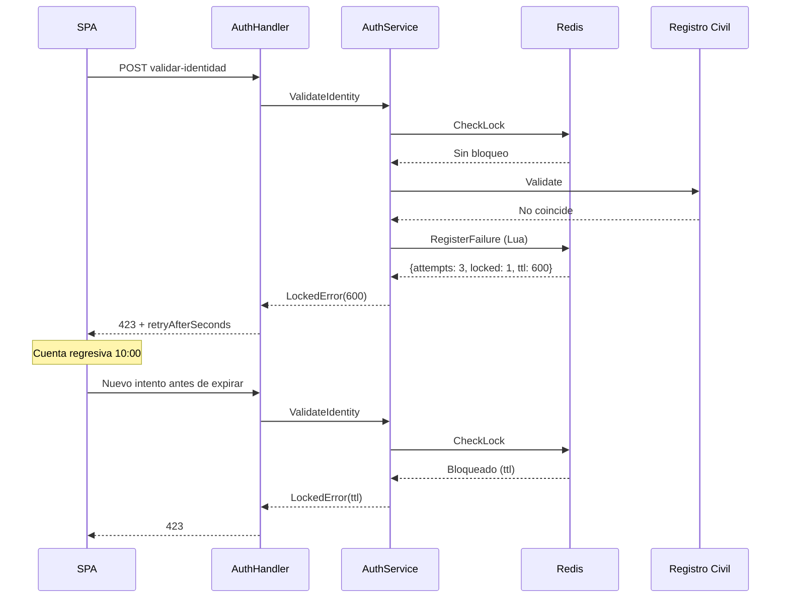

### Claves

- `srp:{env}:auth:reg:attempts:{cedula}`: contador con TTL 600 s.
- `srp:{env}:auth:reg:lock:{cedula}`: marca de bloqueo con TTL 600 s.
- El script Lua incrementa y crea el lock de forma atómica.
- Un error técnico del proveedor no incrementa el contador.
- Al expirar, ambas claves desaparecen y el contador se reinicia.

---

## 10.4 Login y refresh

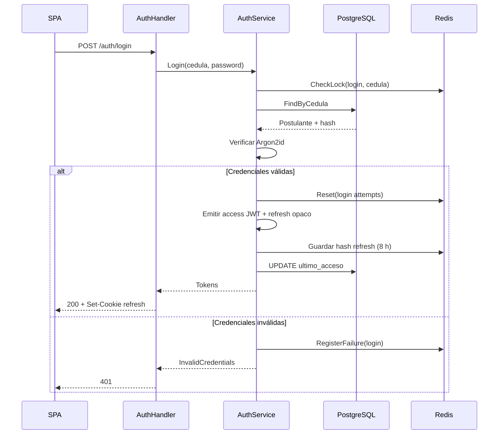

### Refresh

1. La SPA llama `POST /auth/refresh` con la cookie.
2. El servidor busca el hash en Redis.
3. Si es válido, rota el refresh y emite un nuevo access.
4. Si no, responde 401 y la SPA redirige al login.

### Logout

1. `POST /auth/logout`.
2. Se elimina el refresh de Redis.
3. Se agrega el `jti` del access a denylist con TTL restante.
4. Se limpia la cookie.

---

## 10.5 Recuperación de contraseña

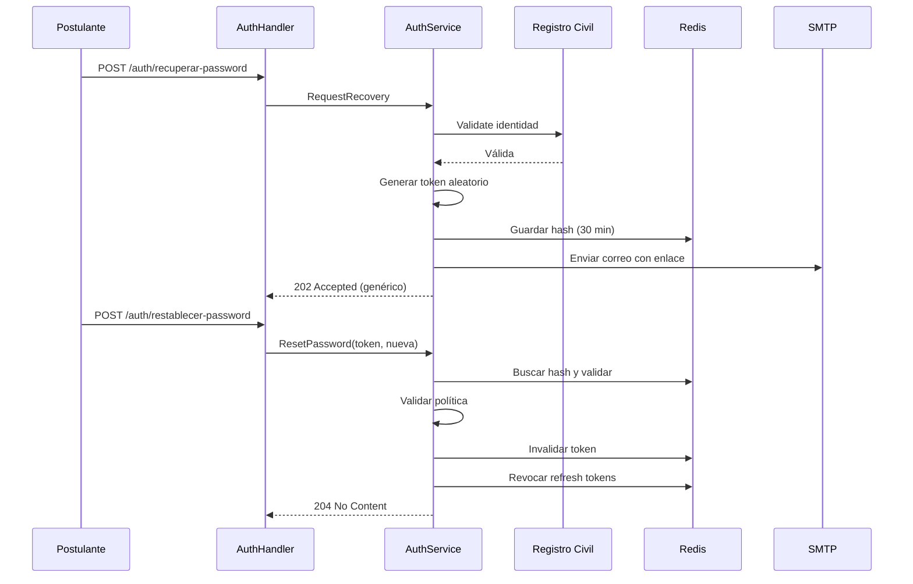

### Reglas

- La respuesta es genérica para evitar enumeración.
- El token es de un solo uso y expira en 30 min.
- Al cambiar la contraseña se revocan las sesiones previas.
- El correo incluye un enlace con el token; el token no se registra en logs.

---

## 10.6 Creación de borrador y guardado de sección

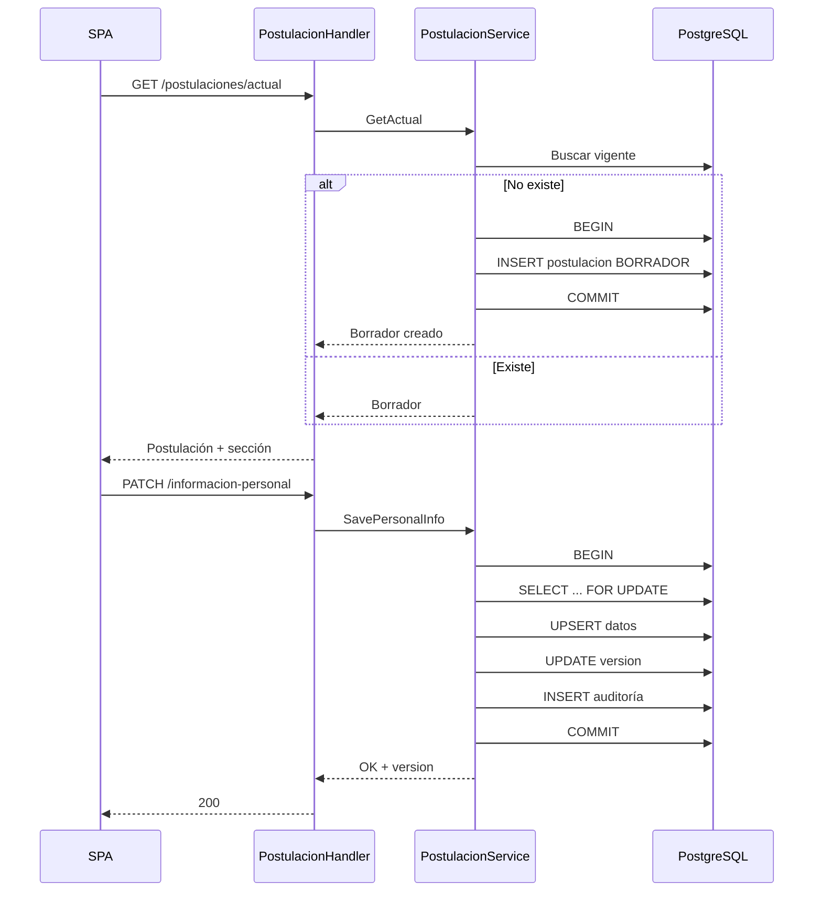

### Reglas

- El borrador se crea una sola vez por postulante y convocatoria.
- Cada sección se guarda en su propia transacción.
- Se usa `version` para detectar conflictos.
- Si la sección tiene ítems repetibles, se guardan en la misma transacción.
- La auditoría registra antes/después.

---

## 10.7 Validación de elegibilidad

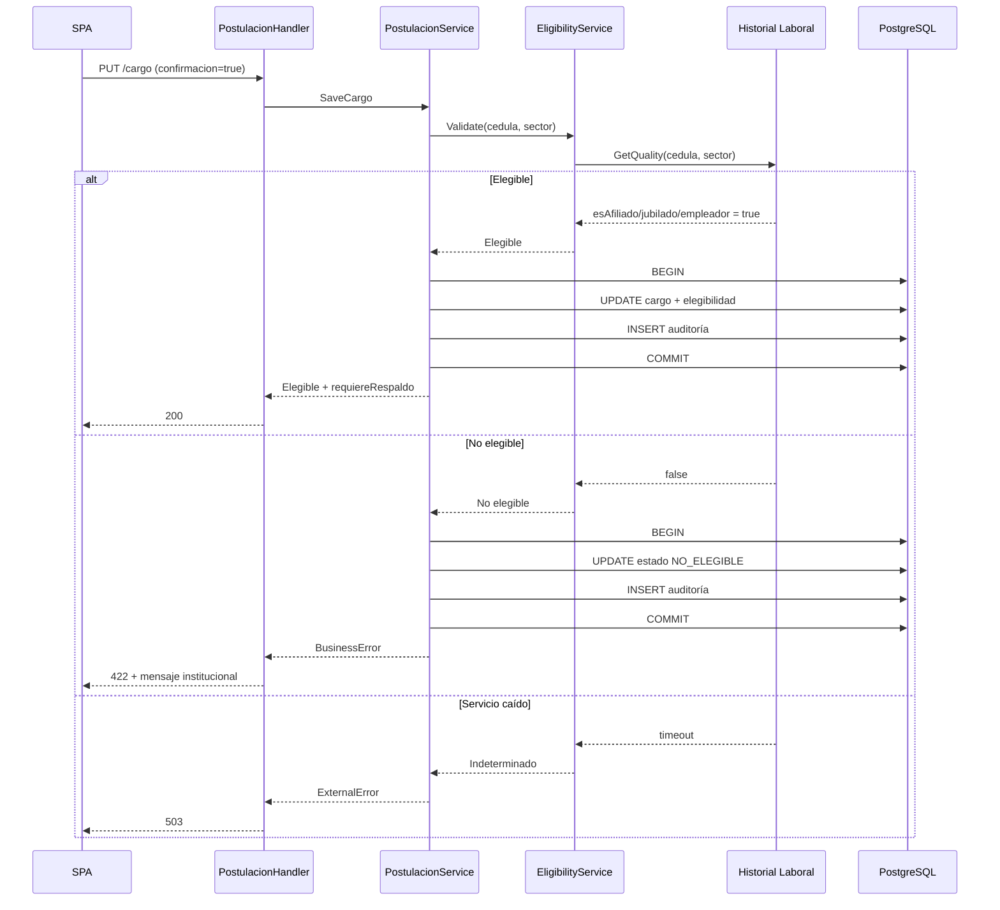

### Reglas

- La confirmación del cargo es obligatoria antes de consultar.
- Un fallo técnico no marca `NO_ELEGIBLE`.
- Un resultado negativo cierra la postulación y audita el motivo.
- El mensaje es el definido en el SRS (`07-reglas-de-negocio.md`).

---

## 10.8 Carga de documento

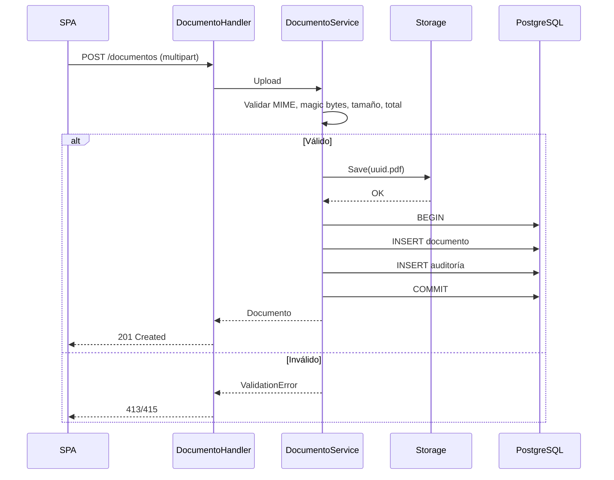

### Compensación

Si el archivo se guarda pero falla la transacción de base de datos:

1. Se ejecuta `ROLLBACK`.
2. Se llama `storage.Delete(key)`.
3. Se registra el incidente.
4. Se devuelve error al usuario.

---

## 10.9 Envío de postulación (transacción crítica)

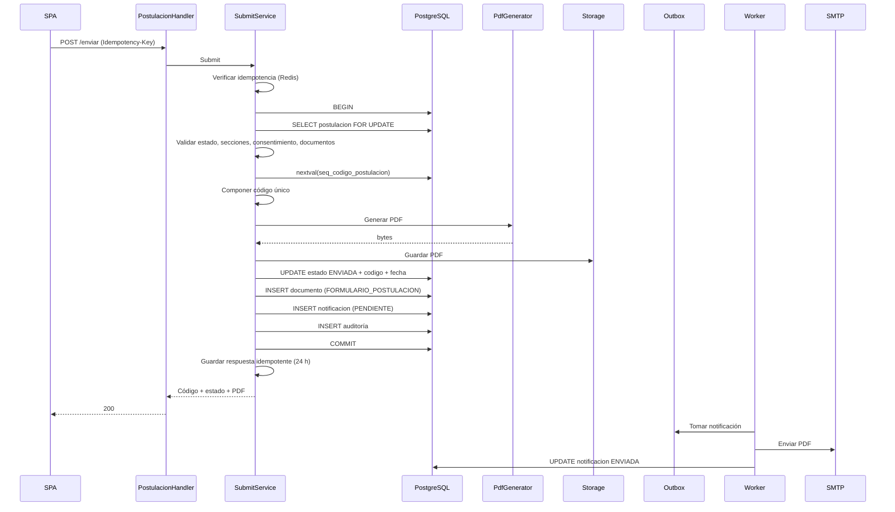

### Límites transaccionales

| Paso | ¿Dentro de la transacción? | Razón |
|---|---|---|
| Validar estado y datos | Sí | Consistencia. |
| Obtener secuencia | Sí | Evitar códigos duplicados. |
| Generar PDF | Sí (o generar antes y confirmar) | Si falla, rollback. |
| Guardar PDF | Sí (registro) / archivo antes | Si falla DB, borrar archivo. |
| Actualizar estado | Sí | Atomicidad. |
| Insertar documento | Sí | Atomicidad. |
| Insertar notificación | Sí | Outbox. |
| Enviar correo | No | No bloquear la transacción. |

### Idempotencia

- Si la postulación ya está `ENVIADA`, se devuelve el mismo código.
- Si existe `srp:{env}:idem:submit:{id}`, se devuelve la respuesta guardada.
- Si no se puede obtener el lock `srp:{env}:lock:submit:{id}`, se responde 409.

### Rollback

Si falla cualquier paso dentro de la transacción:

- No se actualiza el estado.
- No se genera código.
- No se inserta documento.
- No se encola correo.
- Si el PDF se guardó antes, se elimina.

---

## 10.10 Caché de catálogos

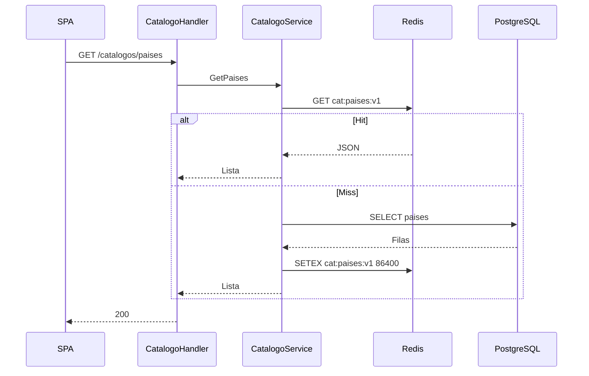

### Invalidación

- Se incrementa `cat:version` cuando cambia un catálogo.
- Las claves nuevas usan la versión nueva.
- Las claves antiguas expiran por TTL.
- No se usa `KEYS *` en producción.

### Fallback

Si Redis falla:

- Se consulta PostgreSQL.
- Se registra una advertencia.
- No se bloquea la lectura.

---

## 10.11 Máquinas de estado

### Postulante

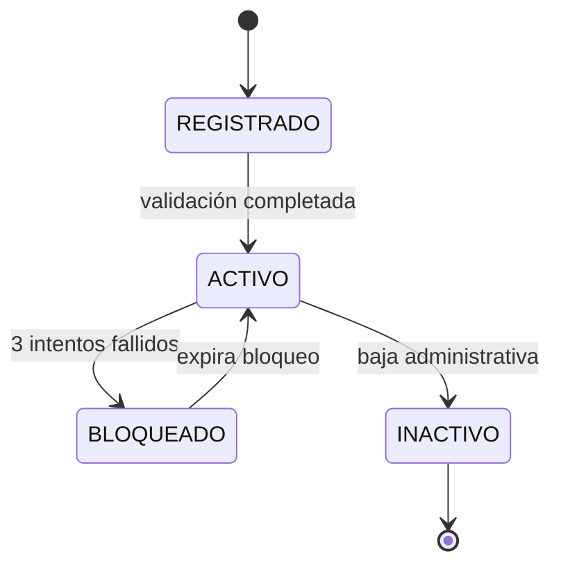

### Postulación

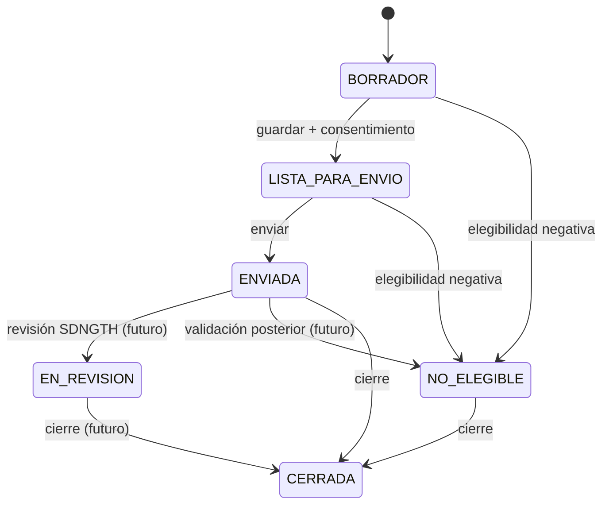

### Reglas

- `ENVIADA` es inmutable.
- `NO_ELEGIBLE` no permite continuar.
- `CERRADA` es solo lectura.
- Las transiciones se validan en el servicio y en la base.

---

## 10.12 Límites transaccionales

| Caso de uso | Transacción | Aislamiento |
|---|---|---|
| Registro | Alta + auditoría. | Read committed. |
| Guardar sección | Upsert + auditoría. | Read committed + `version`. |
| Guardar ítem | Ítem + documento + auditoría. | Read committed. |
| Elegibilidad | Cargo + estado + auditoría. | Read committed. |
| Envío | Estado + código + documento + outbox + auditoría. | Read committed + `FOR UPDATE`. |
| Carga documento | Documento + auditoría. | Read committed. |
| Catálogos | Solo lectura. | — |

### Regla

> Las operaciones de escritura que afectan más de una tabla usan `TxManager.WithTx`. Las lecturas pueden usar el pool directamente.

---

## 10.13 Concurrencia e idempotencia

### Concurrencia optimista

```sql
UPDATE postulacion
SET estado = $1, version = version + 1, fecha_guardado = now()
WHERE id = $2 AND version = $3;
```

Si `RowsAffected() == 0`, se devuelve `POS_CONFLICTO_VERSION`.

### Idempotencia de envío

- `Idempotency-Key` o `postulacionId`.
- Redis guarda la respuesta por 24 h.
- Si la clave existe, se devuelve la misma respuesta.
- Si el estado ya es `ENVIADA`, se devuelve el código existente.

### Lock distribuido

```text
SET srp:{env}:lock:submit:{id} "1" NX PX 10000
```

Si no se obtiene, otro proceso está enviando; se responde 409.

---

## 10.14 Errores y compensaciones

| Falla | Acción |
|---|---|
| Registro Civil no responde | 503; no consumir intento. |
| IESS no responde | 503; no marcar `NO_ELEGIBLE`. |
| Redis no disponible | Catálogos desde DB; auth fail-closed. |
| PDF falla | Rollback; no cambiar estado. |
| Storage falla | Rollback; no insertar documento. |
| DB falla en upload | Borrar archivo; error. |
| SMTP falla | Postulación enviada; outbox reintenta. |
| Correo duplicado | Idempotencia evita duplicado. |
| Conflicto de versión | 409; recargar. |

### Outbox

- La notificación se inserta en la misma transacción del envío.
- El worker la procesa después del commit.
- Reintentos con backoff: 1 min, 5 min, 15 min, 1 h, 6 h.
- Después de 5 intentos, estado `FALLIDA` y alerta.
- La postulación no se revierte por un fallo de correo.

---

## 10.15 Flujo de validación de cédula y proceso de pago con tarjeta y facturación (ADR-013 y ADR-014)

### 10.15.1 Validación algorítmica de cédula (Módulo 10)

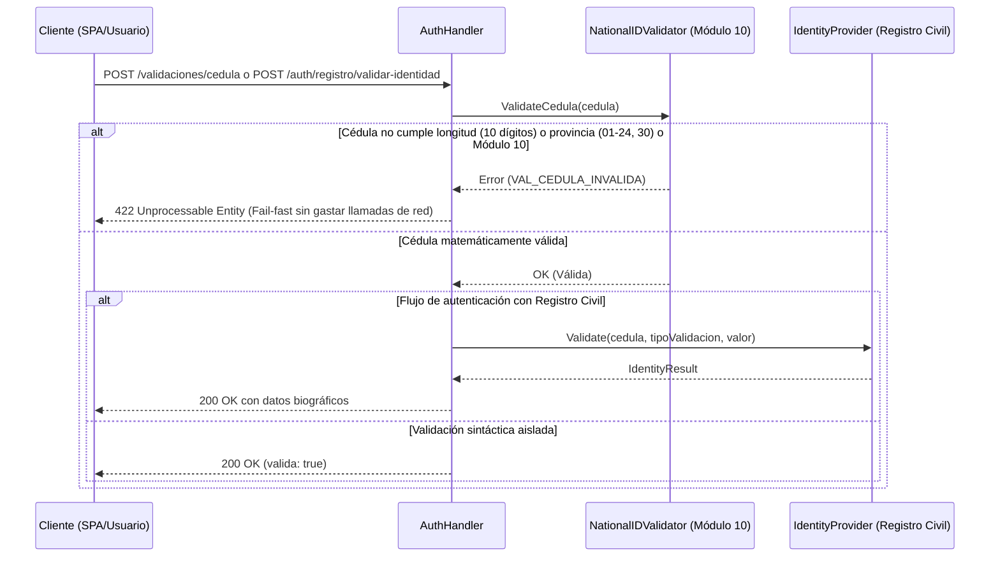

### 10.15.2 Transacción de pago con tarjeta y emisión de factura

> **Retirado (03/11/2026).** La postulación al Directorio del BIESS es gratuita: no se cobra arancel ni tasa y no se emiten facturas. Esta sección se conserva solo como registro. Ver `db/migrations/002_eliminar_pagos.sql` y SRP-010 en `docs/TICKETS.md`.

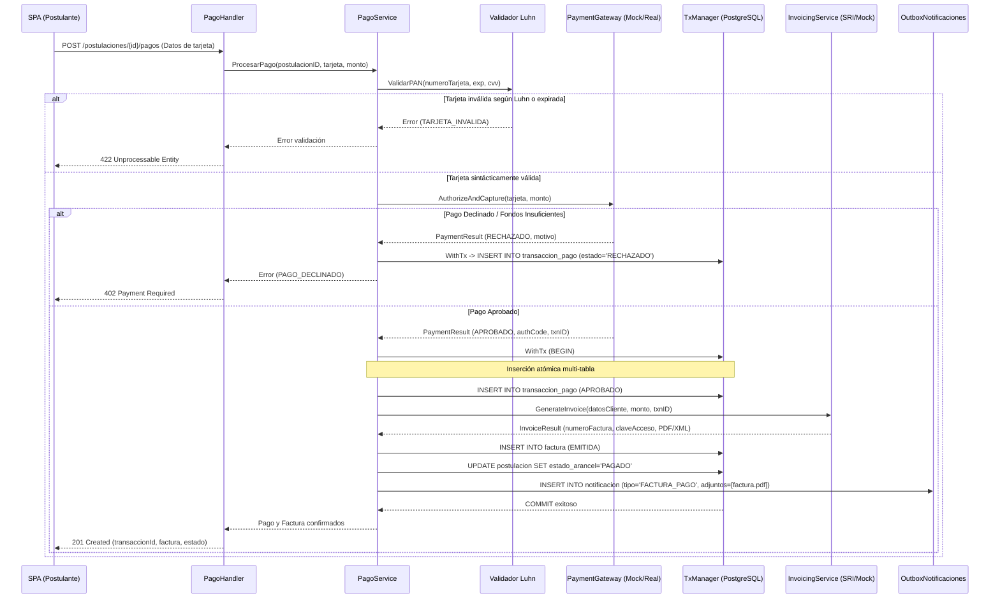

