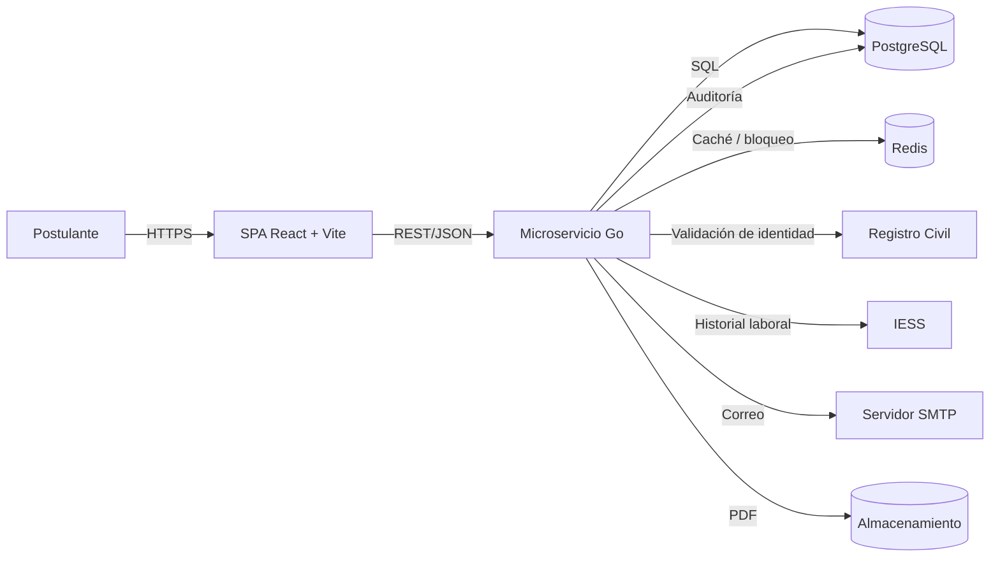

# 01. Introducción — SRS

## 1.1 Propósito

Este documento define los requisitos del **Módulo de Registro y Postulación** del Sistema de Registro y Postulación al Directorio del BIESS (SRP-BIESS). Su propósito es establecer una base común entre el equipo de desarrollo, el docente evaluador y los futuros usuarios institucionales, de modo que el producto pueda diseñarse, implementarse, probarse y aceptarse sin ambigüedades.

El SRS responde a las preguntas: **¿qué problema se resuelve?, ¿quién usa el sistema?, ¿qué debe hacer?, ¿bajo qué reglas?, ¿cómo se verifica?** Las decisiones de cómo construirlo se encuentran en el SDD.

---

## 1.2 Alcance

### 1.2.1 Dentro del alcance

| Código | Capacidad | Resultado esperado |
|---|---|---|
| EF-11 | Registro y autenticación | El postulante valida su identidad, crea sus credenciales, inicia sesión, recupera su contraseña y es bloqueado temporalmente tras intentos fallidos. |
| EF-12 | Formulario de postulación | El postulante completa sus datos personales, domicilio, información adicional, cargo, formación, experiencia, publicaciones, capacitación, inhabilidades y consentimiento; guarda progreso, envía y obtiene su formulario en PDF. |
| Soporte | Catálogos geográficos | País, provincia y cantón con cascada y caché. |
| Soporte | Documentos | Carga de PDF con límites de tamaño y tipo, almacenamiento seguro y descarga. |
| Soporte | Notificaciones | Correo de recuperación y correo con el PDF de la postulación. |
| Soporte | Auditoría | Trazabilidad de eventos críticos y cambios. |

### 1.2.2 Fuera del alcance

- **EF-13:** módulo de administración, dashboard, publicación de fases y matriz comparativa.
- **EF-14:** banco de preguntas, evaluación teórica, aleatoriedad, temporizador y calificación.
- Calificación de méritos, fase de oposición, reconsideraciones, listas de elegibles y reportes finales.
- Integraciones productivas con Registro Civil e Historial Laboral del IESS; en esta fase se implementan **adaptadores y simuladores**.
- Despliegue en infraestructura institucional real, alta disponibilidad geográfica y soporte 24/7.

### 1.2.3 Frontera del producto

---

## 1.3 Contexto del negocio

El IESS, mediante la Resolución C.D. 701, dispuso la ejecución del concurso público de méritos y oposición para designar a los Miembros Principales y Alternos del Directorio del BIESS, en representación de los afiliados, jubilados y empleadores. La Disposición Transitoria Primera establece un plazo de 30 días para elaborar y publicar el formulario de postulación en los portales institucionales.

El proceso manual —recepción de documentos, verificación de requisitos, control de plazos y notificaciones— es inviable por volumen, riesgo de error y exposición a observaciones de control. El módulo inicial digitaliza la **puerta de entrada** del concurso: registro confiable, autenticación segura y captura estructurada de la postulación.

### Problemas que resuelve

| Problema actual | Respuesta del sistema |
|---|---|
| Suplantación de identidad | Validación contra Registro Civil con cédula + fecha de expedición o código dactilar. |
| Registros duplicados | Cédula y correo únicos; una postulación vigente por postulante y convocatoria. |
| Pérdida de avance del formulario | Guardado de progreso por sección y reanudación del borrador. |
| Documentos dispersos y fuera de formato | Carga controlada de PDF, límites por documento y total, almacenamiento centralizado. |
| Postulaciones de personas no elegibles | Validación de nacionalidad y de calidad de afiliado, jubilado o empleador. |
| Falta de trazabilidad | Auditoría de eventos y cambios con actor, fecha, IP y datos anteriores/posteriores. |
| Correos manuales | Notificación automática con PDF adjunto y registro de envío. |

---

## 1.4 Definiciones, acrónimos y abreviaturas

| Término | Definición |
|---|---|
| **BIESS** | Banco del Instituto Ecuatoriano de Seguridad Social. |
| **IESS** | Instituto Ecuatoriano de Seguridad Social. |
| **SDNGTH** | Subdirección Nacional de Gestión de Talento Humano. |
| **Concurso** | Concurso público de méritos y oposición para el Directorio del BIESS. |
| **Postulante** | Persona natural que se registra y presenta su postulación. |
| **Postulación** | Expediente digital del postulante para un cargo y una convocatoria. |
| **EF-11** | Especificación funcional de registro y autenticación. |
| **EF-12** | Especificación funcional del formulario de postulación. |
| **SPA** | Single Page Application. |
| **API REST** | Interfaz de programación de aplicaciones basada en HTTP y JSON. |
| **JWT** | JSON Web Token; credencial de acceso firmada. |
| **TTL** | Time To Live; tiempo de expiración de una clave en caché. |
| **PDF** | Portable Document Format; único formato permitido para respaldos. |
| **SENESCYT** | Secretaría de Educación Superior, Ciencia, Tecnología e Innovación. |
| **SRI** | Servicio de Rentas Internas. |
| **UAFE** | Unidad de Análisis Financiero y Económico. |
| **LOPDP** | Ley Orgánica de Protección de Datos Personales (Ecuador). |
| **MoSCoW** | Técnica de priorización: Must, Should, Could, Won't. |
| **RBAC** | Control de acceso basado en roles. |
| **PII** | Información personal identificable. |

---

## 1.5 Referencias

| Código | Documento | Uso |
|---|---|---|
| REF-01 | Requerimiento Funcional v1.4 — IESS, 26/03/2026 | Fuente de EF-11, EF-12 y restricciones. |
| REF-02 | Resolución C.D. 701 del Consejo Directivo del IESS | Sustento legal del concurso. |
| REF-03 | Examen Práctico del Primer Parcial — Frameworks de Programación Web | Rúbrica y alcance técnico. |
| REF-04 | ISO/IEC/IEEE 29148:2018 | Estructura y calidad del SRS. |
| REF-05 | IEEE 1016-2009 | Estructura del SDD. |
| REF-06 | ISO/IEC 25010:2011 | Modelo de calidad del producto. |
| REF-07 | OWASP ASVS 4.0.3 y OWASP Top 10 2021 | Controles de seguridad. |
| REF-08 | RFC 7807 | Formato de errores de API. |
| REF-09 | Ley Orgánica de Protección de Datos Personales (Ecuador) | Tratamiento de datos personales. |

---

## 1.6 Visión general del documento

El capítulo 2 describe el producto, los actores y las restricciones. El capítulo 3 especifica los requisitos funcionales. El capítulo 4 define los atributos de calidad. El capítulo 5 describe los requisitos de datos. El capítulo 6 cubre las interfaces. El capítulo 7 concentra las reglas de negocio. El capítulo 8 establece la trazabilidad y verificación. El capítulo 9 contiene los criterios de aceptación en formato Gherkin. El capítulo 10 reúne anexos, mensajes y pendientes.

---

## 1.7 Interesados y clases de usuarios

| Interesado | Interés principal | Influencia |
|---|---|---|
| Postulante | Registrarse, completar y enviar su postulación sin pérdida de información. | Alta |
| SDNGTH | Recibir postulaciones completas, elegibles y auditables. | Alta |
| Comisión de Selección | Disponer de información confiable para las siguientes fases. | Media |
| Dirección Nacional de TI | Cumplir estándares de seguridad, arquitectura y operación. | Alta |
| Registro Civil | Proveer validación de identidad. | Media |
| IESS — Historial Laboral | Proveer calidad de afiliado, jubilado o empleador. | Media |
| Auditoría / Contraloría | Verificar trazabilidad y cumplimiento normativo. | Media |
| Docente evaluador | Verificar el cumplimiento de la rúbrica. | Alta |

### Clases de usuarios de esta fase

| Clase | Descripción | Permisos |
|---|---|---|
| **Postulante** | Usuario externo registrado. | Crear y editar su borrador, cargar documentos, enviar su postulación, consultar su estado y descargar su PDF. |
| **Sistema** | Actor interno (procesos automáticos). | Validar identidad, calcular tiempos, generar PDF, enviar correos, auditar. |
| **Analista SDNGTH** | Usuario institucional futuro (EF-13). | Consultar postulaciones y validar información. No implementado en esta fase. |

---

## 1.8 Supuestos y dependencias

| Código | Supuesto / dependencia | Impacto si no se cumple |
|---|---|---|
| SUP-01 | Registro Civil expone un servicio de validación o se dispone de un simulador aprobado. | No se puede registrar al postulante. |
| SUP-02 | Historial Laboral del IESS expone la calidad de afiliado, jubilado o empleador o se dispone de un simulador. | No se puede validar elegibilidad. |
| SUP-03 | La fase de postulación se habilita por configuración (futuro EF-13). | El formulario no debe abrirse. |
| SUP-04 | Existe un servidor SMTP institucional o uno de pruebas (Mailpit). | No se envían correos de recuperación ni de postulación. |
| SUP-05 | El almacenamiento de archivos está disponible (volumen local o S3 compatible). | No se pueden cargar documentos. |
| SUP-06 | El navegador del postulante permite descargar PDF y usar HTTPS. | No se completa el flujo. |
| SUP-07 | La normativa de protección de datos se aplica desde el primer registro. | Riesgo legal y observaciones de auditoría. |

---

## 1.9 Objetivos del producto y métricas de éxito

| Objetivo | Métrica | Meta |
|---|---|---|
| Digitalizar el registro y la postulación | Porcentaje de postulaciones recibidas por el módulo | 100 % en la fase piloto. |
| Validar identidad en línea | Registros con identidad validada | ≥ 99 % de registros exitosos. |
| Reducir pérdida de información | Borradores recuperables | 100 % de secciones guardadas. |
| Garantizar integridad | Postulaciones enviadas con transacción atómica | 100 % sin registros huérfanos. |
| Proteger la cuenta | Bloqueo tras 3 intentos fallidos | 100 % de los casos. |
| Dar trazabilidad | Eventos críticos auditados | 100 % de registro, login, cambios y envío. |
| Cumplir protección de datos | Consentimiento informado registrado | 100 % de postulaciones enviadas. |
| Ser usable | Formulario responsive y accesible | WCAG 2.1 AA en flujos críticos. |

---

## 1.10 Convenciones de redacción

- **“Debe”** indica un requisito obligatorio.
- **“Debería”** indica una recomendación fuerte.
- **“Puede”** indica una capacidad opcional.
- Los requisitos son verificables: cada uno tiene criterio de aceptación o método de verificación.
- Los mensajes al usuario se escriben entre comillas y se centralizan en el catálogo de mensajes del anexo.
- Las referencias a EF-11 y EF-12 conservan la numeración del requerimiento institucional.
