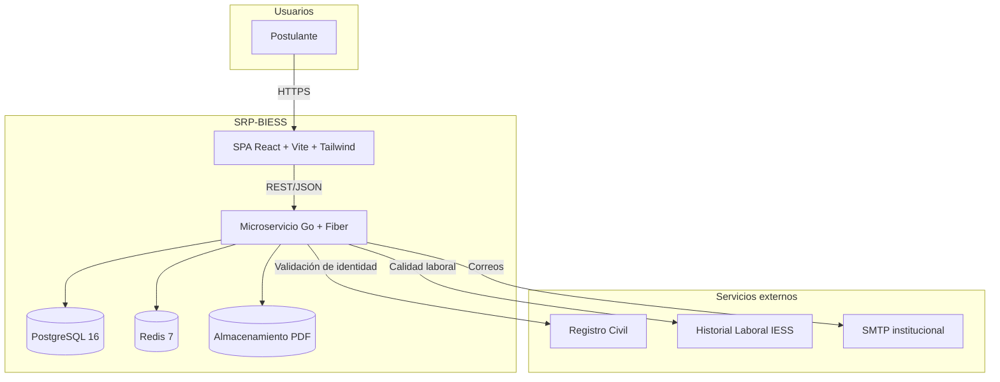
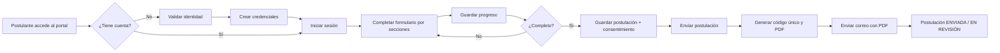

# 02. Descripción general — SRS

## 2.1 Perspectiva del producto

El SRP-BIESS es un **módulo web transaccional** que se integra al ecosistema institucional del IESS/BIESS. No es un sistema aislado: consume servicios de identidad y de historial laboral, utiliza la base de datos institucional PostgreSQL, se apoya en Redis para caché y control de intentos, y envía notificaciones por correo.

### 2.1.1 Contexto del sistema

### 2.1.2 Principios de producto

1. **Seguridad desde el diseño:** la identidad se valida antes de crear la cuenta; las credenciales se almacenan con hash; las rutas se protegen por sesión.
2. **Integridad transaccional:** una postulación enviada no puede quedar a medias; el guardado y el envío usan transacciones.
3. **Progresividad:** el formulario se completa por secciones y se guarda el avance.
4. **Trazabilidad:** cada evento crítico queda auditado.
5. **Cumplimiento:** consentimiento informado, minimización de datos y retención controlada.
6. **Usabilidad:** interfaz responsiva, mensajes claros y estados de carga/error visibles.

---

## 2.2 Funciones del producto

| Grupo | Funciones |
|---|---|
| **Acceso** | Página de inicio, registro, validación de identidad, inicio de sesión, recuperación y restablecimiento de contraseña, cierre de sesión. |
| **Seguridad de cuenta** | Bloqueo temporal tras 3 intentos fallidos, control de intentos, expiración de sesión, rutas protegidas. |
| **Postulación** | Creación de borrador, navegación por secciones, guardado de progreso, edición y eliminación de ítems, validaciones en servidor. |
| **Datos personales** | Autocompletado desde Registro Civil, restricción de nacionalidad, estado civil y datos de pareja. |
| **Domicilio y contacto** | País, provincia, cantón, dirección, teléfonos y correos; captura manual para el extranjero. |
| **Información adicional** | Familiares en IESS/BIESS con parentesco, institución, área y cargo. |
| **Cargo y elegibilidad** | Selección de sector (afiliados, jubilados, empleadores), validación con Historial Laboral y respaldo organizacional. |
| **Formación y trayectoria** | Formación académica, experiencia profesional con cálculo de tiempo, publicaciones y capacitación. |
| **Inhabilidades** | Cuestionario legal con preguntas obligatorias y datos de remoción. |
| **Documentos** | Carga de PDF, validación de tipo/tamaño, almacenamiento, descarga y eliminación. |
| **Envío** | Consentimiento, generación de código único, PDF, correo y bloqueo de edición. |
| **Consulta** | Resumen de la postulación, estado y descarga del PDF. |
| **Soporte** | Catálogos geográficos, caché, auditoría, notificaciones y salud del servicio. |

---

## 2.3 Características de los usuarios

| Usuario | Conocimiento técnico | Contexto de uso | Necesidad principal |
|---|---|---|---|
| Postulante | Básico–medio | Computadora o móvil, desde cualquier lugar. | Completar un formulario largo sin perder datos y con instrucciones claras. |
| Postulante con discapacidad | Variable | Puede usar lector de pantalla o teclado. | Accesibilidad y mensajes comprensibles. |
| Analista SDNGTH (futuro) | Medio–alto | Oficina, revisión de expedientes. | Información completa, ordenada y auditable. |
| Administrador (futuro) | Alto | Oficina, configuración de fases. | Control de apertura/cierre y publicación. |
| Auditor | Medio | Revisión posterior. | Trazabilidad y evidencia de cambios. |

### Necesidades especiales

- El postulante puede tardar en reunir documentos; requiere **guardar progreso**.
- Puede perder conexión; el sistema debe informar y permitir reintentar sin duplicar.
- Puede equivocarse en la selección del cargo; el sistema debe **confirmar** antes de una validación definitiva.
- Puede no ser ecuatoriano; el sistema debe explicar con claridad que no puede continuar.

---

## 2.4 Entorno de operación

| Componente | Entorno de desarrollo | Entorno de producción objetivo |
|---|---|---|
| Navegador | Chrome/Edge/Firefox/Safari últimas 2 versiones. | Mismos navegadores; soporte responsive desde 360 px. |
| Frontend | Vite dev server, Node.js 20 LTS. | Build estático servido por Nginx/CDN. |
| Backend | Go 1.23+, Fiber v2, aire para recarga. | Contenedor Linux, 2+ réplicas detrás de balanceador. |
| Base de datos | PostgreSQL 16 en Docker. | PostgreSQL 16 administrado, respaldo y réplica. |
| Caché | Redis 7 en Docker. | Redis 7 administrado, con persistencia y alertas. |
| Archivos | Volumen local. | Object storage S3 compatible o volumen cifrado. |
| Correo | Mailpit local. | SMTP institucional con TLS. |
| Observabilidad | Logs de consola. | Logs estructurados, métricas y trazas. |

### Requisitos de red

- HTTPS obligatorio en producción (TLS 1.2+).
- CORS restringido al dominio de la SPA.
- Salida a Registro Civil, Historial Laboral y SMTP.
- Puertos de PostgreSQL y Redis no expuestos a Internet.

---

## 2.5 Restricciones de diseño e implementación

| Código | Restricción | Origen |
|---|---|---|
| RES-01 | Frontend SPA con React + Vite + Tailwind CSS. | Rúbrica del examen. |
| RES-02 | Backend en Go con Fiber o Gin, arquitectura en capas e inyección de dependencias. | Rúbrica del examen. |
| RES-03 | Persistencia relacional en PostgreSQL con transacciones. | Rúbrica del examen. |
| RES-04 | Redis para bloqueo de intentos y caché de catálogos. | Rúbrica del examen. |
| RES-05 | Documentos únicamente en PDF. | RF v1.4. |
| RES-06 | Respaldo organizacional: máximo 4 MB. | RF v1.4, EF-12. |
| RES-07 | Formación, experiencia, publicaciones y capacitación: máximo 2 MB por documento. | RF v1.4, EF-12. |
| RES-08 | Máximo 50 MB por postulante en total. | RF v1.4, EF-1. |
| RES-09 | Bloqueo de 10 minutos al tercer intento fallido. | RF v1.4, EF-11; rúbrica. |
| RES-10 | Nacionalidad ecuatoriana obligatoria. | RF v1.4, EF-12. |
| RES-11 | Formulario en español, fechas DD/MM/AAAA en interfaz. | RF v1.4 y contexto institucional. |
| RES-12 | Cumplimiento de LOPDP y consentimiento informado. | RF v1.4 y ley aplicable. |

---

## 2.6 Supuestos y dependencias

Se detallan en `01-introduccion.md` (SUP-01 a SUP-07). Para el diseño se asume que:

- Los servicios externos pueden simularse con adaptadores deterministas para la demostración académica.
- La fase de postulación se controla con una bandera de configuración (`fase_postulacion_habilitada`).
- El correo electrónico es el canal oficial de notificación.
- El postulante dispone de un documento de identidad vigente.
- La información de catálogos geográficos se carga desde el RF v1.4 y fuentes oficiales.

---

## 2.7 Asignación de requisitos por fase

| Fase | Alcance | Estado |
|---|---|---|
| **Fase 1 — Primer parcial** | EF-11, EF-12, catálogos, documentos, correo, auditoría. | En desarrollo. |
| **Fase 2 — Administración** | EF-13: dashboard, publicación de fases, históricos, matriz comparativa. | Futuro. |
| **Fase 3 — Evaluación** | EF-14: banco de preguntas, examen, calificación, notificación. | Futuro. |
| **Fase 4 — Méritos y oposición** | Calificación, reconsideraciones, listas de elegibles. | Futuro. |

---

## 2.8 Proceso de negocio de alto nivel

### Hitos de negocio

1. **Registro exitoso:** identidad validada y credenciales creadas.
2. **Borrador creado:** postulación en estado `BORRADOR`.
3. **Postulación guardada:** estado `LISTA_PARA_ENVIO`, con validaciones completas.
4. **Postulación enviada:** estado `ENVIADA`, código único, PDF y correo.
5. **Revisión:** estado `EN_REVISION` o `NO_ELEGIBLE` según validaciones.

---

## 2.9 Métricas de éxito del producto

| Métrica | Fórmula | Meta |
|---|---|---|
| Tasa de registro exitoso | Registros completados / intentos válidos | ≥ 95 % |
| Tasa de postulaciones enviadas | Enviadas / borradores creados | ≥ 80 % |
| Tiempo medio de completitud | Promedio desde borrador hasta envío | ≤ 45 min |
| Errores de validación por envío | Validaciones fallidas / envíos | ≤ 5 % |
| Disponibilidad | Minutos disponibles / minutos del mes | ≥ 99.5 % |
| Cobertura de auditoría | Eventos críticos auditados / eventos críticos | 100 % |

---

## 2.10 Resumen de interfaces

| Interfaz | Tipo | Propósito |
|---|---|---|
| SPA ↔ API | REST/JSON sobre HTTPS | Todas las operaciones del postulante. |
| API ↔ PostgreSQL | SQL/TCP | Persistencia transaccional. |
| API ↔ Redis | RESP/TCP | Caché, bloqueo, rate limiting y tokens temporales. |
| API ↔ Registro Civil | REST/JSON | Validación de identidad. |
| API ↔ Historial Laboral IESS | REST/JSON | Calidad de afiliado, jubilado o empleador. |
| API ↔ SMTP | SMTP/TLS | Correos de recuperación y envío. |
| API ↔ Almacenamiento | API de archivos | Guardar y recuperar PDF. |
| Usuario ↔ SPA | Navegador | Formularios, mensajes y descargas. |

El detalle se encuentra en `06-interfaces-externas.md` y en `SDD/07-diseno-api-rest.md`.
