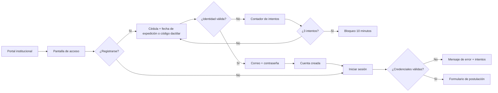

# 03. Requisitos funcionales — SRS

## 3.1 Convenciones de especificación

Cada requisito se documenta con la siguiente estructura mínima:

| Campo | Descripción |
|---|---|
| **ID** | Identificador único y estable. |
| **Nombre** | Acción o capacidad verificable. |
| **Prioridad** | MoSCoW (`Must`, `Should`, `Could`, `Won't`). |
| **Actor** | Quién ejecuta o recibe el resultado. |
| **Descripción** | Comportamiento observable. |
| **Precondiciones** | Estado necesario antes de ejecutar. |
| **Flujo principal** | Pasos normales. |
| **Excepciones** | Errores y caminos alternativos. |
| **Postcondiciones** | Estado resultante. |
| **Reglas** | `RN-xx` aplicables. |
| **Criterios de aceptación** | Evidencia de cumplimiento. |

**Reglas de redacción:** los requisitos usan “debe” para obligaciones; los mensajes exactos se conservan entre comillas; las fechas de interfaz se expresan `DD/MM/AAAA`; los identificadores de API y base de datos usan `snake_case` o `camelCase` según corresponda.

---

## 3.2 Actores

| Actor | Tipo | Descripción | Alcance |
|---|---|---|---|
| **Postulante** | Primario | Persona que se registra y presenta su postulación. | EF-11 y EF-12. |
| **Sistema** | Secundario | Validaciones automáticas, cálculo de tiempos, generación de PDF, correos y auditoría. | Transversal. |
| **Registro Civil** | Externo | Valida cédula con fecha de expedición o código dactilar. | EF-11 y EF-12. |
| **Historial Laboral IESS** | Externo | Informa calidad de afiliado, jubilado o empleador. | EF-12. |
| **Servicio de correo** | Externo | Entrega enlaces de recuperación y PDF de postulación. | EF-11 y EF-12. |
| **Analista SDNGTH** | Futuro | Consulta y valida postulaciones. | EF-13 (fuera de alcance). |

---

## 3.3 Catálogo de requisitos funcionales

### 3.3.1 Módulo EF-11 — Registro y autenticación

| ID | Requisito | Prioridad |
|---|---|---|
| RF-EF11-01 | Acceso al módulo y página de inicio con opciones “Iniciar sesión” y “Registrarse”. | Must |
| RF-EF11-02 | Validación de identidad con cédula y fecha de expedición o código dactilar. | Must |
| RF-EF11-03 | Registro de correo electrónico y contraseña tras validar identidad. | Must |
| RF-EF11-04 | Bloqueo temporal de 10 minutos al tercer intento fallido de registro. | Must |
| RF-EF11-05 | Inicio de sesión con cédula y contraseña. | Must |
| RF-EF11-06 | Control de intentos fallidos y bloqueo temporal de inicio de sesión. | Should |
| RF-EF11-07 | Recuperación de contraseña mediante validación de identidad y correo. | Must |
| RF-EF11-08 | Restablecimiento de contraseña con token de un solo uso. | Must |
| RF-EF11-09 | Gestión de sesión, cierre de sesión y rutas protegidas. | Must |
| RF-EF11-10 | Redirección obligatoria al formulario en el primer ingreso. | Must |
| RF-EF11-11 | Auditoría de eventos de autenticación y bloqueo. | Should |

### 3.3.2 Módulo EF-12 — Formulario de postulación

| ID | Requisito | Prioridad |
|---|---|---|
| RF-EF12-01 | Creación y reanudación del borrador de postulación. | Must |
| RF-EF12-02 | Navegación por secciones y guardado de progreso. | Must |
| RF-EF12-03 | Información personal autocompletada desde Registro Civil. | Must |
| RF-EF12-04 | Restricción estricta de nacionalidad ecuatoriana. | Must |
| RF-EF12-05 | Registro de estado civil y datos de pareja cuando corresponda. | Must |
| RF-EF12-06 | Información domiciliaria y de contacto. | Must |
| RF-EF12-07 | Cascada país → provincia → cantón y captura manual en el extranjero. | Must |
| RF-EF12-08 | Información adicional de familiares en IESS/BIESS. | Must |
| RF-EF12-09 | Selección del cargo al que postula. | Must |
| RF-EF12-10 | Validación de elegibilidad según el sector del cargo. | Must |
| RF-EF12-11 | Respaldo organizacional y documento PDF. | Must |
| RF-EF12-12 | Formación académica con documentos de respaldo. | Must |
| RF-EF12-13 | Experiencia profesional con cálculo automático de tiempo. | Must |
| RF-EF12-14 | Publicaciones e investigaciones académicas. | Must |
| RF-EF12-15 | Capacitación (cursos, seminarios y talleres). | Must |
| RF-EF12-16 | Cuestionario de inhabilidades y datos de remoción. | Must |
| RF-EF12-17 | Gestión de documentos adjuntos en PDF. | Must |
| RF-EF12-18 | Guardar postulación y aceptar consentimiento informado. | Must |
| RF-EF12-19 | Enviar postulación con validación integral. | Must |
| RF-EF12-20 | Generación de código único y PDF de postulación. | Must |
| RF-EF12-21 | Consulta de resumen, estado y descarga del PDF. | Must |
| RF-EF12-22 | Bloqueo de edición después del envío. | Must |
| RF-EF12-23 | Notificación por correo con el PDF adjunto. | Must |
| RF-EF12-24 | Validación integral en servidor de todas las reglas. | Must |
| RF-EF12-25 | Auditoría de cambios de la postulación. | Should |
| RF-EF12-26 | Edición y eliminación de ítems repetibles. | Must |

### 3.3.3 Catálogos geográficos

| ID | Requisito | Prioridad |
|---|---|---|
| RF-CAT-01 | Listar países activos. | Must |
| RF-CAT-02 | Listar provincias de Ecuador por país. | Must |
| RF-CAT-03 | Listar cantones por provincia. | Must |
| RF-CAT-04 | Cachear catálogos en Redis con TTL. | Must |
| RF-CAT-05 | Invalidar o versionar la caché cuando cambie un catálogo. | Should |

### 3.3.4 Validaciones avanzadas, pago con tarjeta y facturación

| ID | Requisito | Prioridad |
|---|---|---|
| RF-VAL-01 | Validación algorítmica de cédula de ciudadanía ecuatoriana mediante Módulo 10. | Must |
| RF-PAG-01 | **Retirado (03/11/2026): la postulación es gratuita.** Procesamiento de pago con tarjeta de crédito/débito, validación de Luhn y pasarela mockeable. | Must |
| RF-PAG-02 | **Retirado (03/11/2026): la postulación es gratuita.** Emisión automática de factura electrónica con clave de acceso SRI y envío por correo electrónico. | Must |

---

## 3.4 Especificación del módulo EF-11

### 3.4.1 Visión general del registro y autenticación

### 3.4.2 RF-EF11-01 — Acceso al módulo y página de inicio

| Campo | Especificación |
|---|---|
| **Prioridad** | Must |
| **Actor** | Postulante |
| **Precondición** | El enlace del concurso está publicado en la página web institucional. |
| **Descripción** | El sistema debe presentar una página de bienvenida con información del concurso y las opciones “Iniciar sesión” y “Registrarse”. |
| **Flujo principal** | 1. El postulante accede al enlace. 2. El sistema muestra el título del concurso, una breve descripción y las dos opciones. 3. El postulante selecciona una opción. |
| **Excepciones** | Si la fase de postulación está cerrada, se muestra un aviso y se deshabilitan las opciones de registro y postulación. |
| **Postcondición** | El postulante se encuentra en el flujo de autenticación o registro. |
| **Reglas** | RN-11 (fase habilitada). |
| **Criterios de aceptación** | La página carga en menos de 2.5 s; las opciones son visibles y accesibles por teclado; el aviso de fase cerrada es claro. |

### 3.4.3 RF-EF11-02 — Validación de identidad

| Campo | Especificación |
|---|---|
| **Prioridad** | Must |
| **Actor** | Postulante / Registro Civil |
| **Precondición** | El postulante seleccionó “Registrarse”. |
| **Descripción** | El sistema debe solicitar cédula y uno de estos datos: fecha de expedición (`DD/MM/AAAA`) o código dactilar (10 dígitos). Debe validar la cédula contra Registro Civil antes de permitir la creación de credenciales. |
| **Flujo principal** | 1. El postulante ingresa cédula y dato de validación. 2. El sistema valida formato y algoritmo de cédula. 3. Consulta Registro Civil. 4. Si coincide, muestra los datos de identidad y habilita correo/contraseña. |
| **Excepciones** | Si el formato es inválido, muestra “La información ingresada es incorrecta”. Si la identidad no coincide, incrementa el contador y muestra el mismo mensaje. Si el servicio externo no responde, muestra “No es posible validar su identidad en este momento. Intente nuevamente.” y no consume intento. |
| **Postcondición** | Identidad validada y token temporal de registro emitido (10 min). |
| **Reglas** | RN-02, RN-06, RN-08. |
| **Criterios de aceptación** | Una cédula válida con dato correcto permite continuar; un dato incorrecto no revela información adicional; el token expira a los 10 min. |

### 3.4.4 RF-EF11-03 — Registro de credenciales

| Campo | Especificación |
|---|---|
| **Prioridad** | Must |
| **Actor** | Postulante |
| **Precondición** | Identidad validada y token temporal vigente. |
| **Descripción** | El sistema debe solicitar correo electrónico y contraseña, validar su formato y crear la cuenta del postulante. |
| **Flujo principal** | 1. El sistema muestra el correo y la contraseña. 2. El postulante ingresa los datos. 3. El sistema valida correo único, contraseña según política y confirmación. 4. Crea la cuenta con estado `ACTIVO`. 5. Muestra “Registro exitoso” y redirige a inicio de sesión. |
| **Excepciones** | Correo ya registrado: “El correo electrónico ya se encuentra registrado”. Contraseña débil: muestra los requisitos incumplidos. Token expirado: solicita reiniciar la validación. |
| **Postcondición** | Postulante creado; token de validación invalidado; evento auditado. |
| **Reglas** | RN-03, RN-04, RN-05. |
| **Criterios de aceptación** | No se crean cuentas duplicadas por cédula ni por correo; la contraseña nunca se almacena en claro; el registro exitoso no inicia sesión automáticamente. |

### 3.4.5 RF-EF11-04 — Bloqueo por intentos fallidos de registro

| Campo | Especificación |
|---|---|
| **Prioridad** | Must |
| **Actor** | Sistema |
| **Precondición** | El postulante intenta validar su identidad. |
| **Descripción** | El sistema debe contar los intentos fallidos de validación de identidad. Al tercer intento fallido consecutivo, debe bloquear el registro durante 10 minutos y mostrar “Registro fallido, inténtelo nuevamente en 10 minutos”. |
| **Flujo principal** | 1. Cada fallo incrementa el contador asociado a la cédula. 2. Al llegar a 3, se crea una clave de bloqueo con TTL de 600 s. 3. Se rechazan nuevos intentos con HTTP 423 y tiempo restante. 4. Al expirar, el contador se reinicia y el postulante puede volver a intentar. |
| **Excepciones** | Si Redis no está disponible, el sistema debe fallar de forma segura (no permitir intentos ilimitados) y registrar el incidente. |
| **Postcondición** | Registro bloqueado temporalmente; evento auditado. |
| **Reglas** | RN-06, RN-08. |
| **Criterios de aceptación** | Tres fallos consecutivos bloquean; el mensaje es exacto; a los 10 min se permite un nuevo intento; un intento exitoso reinicia el contador. |

### 3.4.6 RF-EF11-05 — Inicio de sesión

| Campo | Especificación |
|---|---|
| **Prioridad** | Must |
| **Actor** | Postulante |
| **Precondición** | Cuenta registrada y activa. |
| **Descripción** | El sistema debe autenticar con cédula y contraseña y emitir una sesión válida. |
| **Flujo principal** | 1. El postulante ingresa cédula y contraseña. 2. El sistema valida credenciales. 3. Si son correctas, emite token de acceso y refresh, actualiza último acceso y redirige al formulario o al resumen. |
| **Excepciones** | Credenciales incorrectas: “Sus credenciales de ingreso son incorrectas”. Cuenta bloqueada: mensaje de bloqueo con tiempo restante. Cuenta inactiva: “Su cuenta no se encuentra habilitada”. |
| **Postcondición** | Sesión iniciada; evento auditado. |
| **Reglas** | RN-05, RN-07, RN-09. |
| **Criterios de aceptación** | No se revela si la cédula existe; el mensaje de error es genérico; el acceso a rutas protegidas sin token redirige al login. |

### 3.4.7 RF-EF11-06 — Bloqueo por intentos fallidos de inicio de sesión

| Campo | Especificación |
|---|---|
| **Prioridad** | Should |
| **Actor** | Sistema |
| **Precondición** | El postulante intenta iniciar sesión. |
| **Descripción** | Por seguridad, el sistema debe aplicar la misma política de 3 intentos fallidos y bloqueo de 10 minutos al inicio de sesión, aunque el RF solo lo exige para el registro. |
| **Flujo principal** | 1. Cada credencial incorrecta incrementa el contador por cédula. 2. Al tercer fallo, se bloquea el login 10 minutos. 3. Se muestra “Cuenta bloqueada temporalmente. Intente nuevamente en 10 minutos”. |
| **Excepciones** | Un login exitoso reinicia el contador. El bloqueo no afecta la recuperación de contraseña. |
| **Postcondición** | Login bloqueado temporalmente; evento auditado. |
| **Reglas** | RN-07, RN-08. |
| **Criterios de aceptación** | Tres fallos bloquean; el bloqueo expira a los 10 min; el contador se reinicia al autenticarse correctamente. |

### 3.4.8 RF-EF11-07 — Recuperación de contraseña

| Campo | Especificación |
|---|---|
| **Prioridad** | Must |
| **Actor** | Postulante / Registro Civil / SMTP |
| **Precondición** | El postulante selecciona “¿Olvidaste tu contraseña?”. |
| **Descripción** | El sistema debe solicitar cédula y fecha de expedición o código dactilar; si la validación es correcta, debe enviar un correo con un enlace para restablecer la contraseña. |
| **Flujo principal** | 1. El postulante ingresa cédula y dato de validación. 2. El sistema valida identidad. 3. Genera un token aleatorio de un solo uso. 4. Almacena su hash con TTL de 30 min. 5. Envía el enlace al correo registrado. 6. Muestra un mensaje genérico de confirmación. |
| **Excepciones** | Identidad inválida: mensaje genérico, sin revelar si la cuenta existe. SMTP caído: se registra el error y se muestra “No fue posible enviar el correo. Intente más tarde”. |
| **Postcondición** | Token de recuperación emitido y correo encolado. |
| **Reglas** | RN-02, RN-09. |
| **Criterios de aceptación** | El enlace llega al correo registrado; el token expira a los 30 min; un token usado no puede reutilizarse. |

### 3.4.9 RF-EF11-08 — Restablecimiento de contraseña

| Campo | Especificación |
|---|---|
| **Prioridad** | Must |
| **Actor** | Postulante |
| **Precondición** | Token de recuperación válido. |
| **Descripción** | El sistema debe permitir establecer una nueva contraseña que cumpla la política y debe invalidar el token y las sesiones anteriores. |
| **Flujo principal** | 1. El postulante abre el enlace. 2. Ingresa la nueva contraseña y su confirmación. 3. El sistema valida política y token. 4. Actualiza el hash. 5. Invalida el token y los refresh tokens. 6. Redirige al login con mensaje de éxito. |
| **Excepciones** | Token expirado o usado: “El enlace de recuperación expiró. Solicite uno nuevo”. Contraseña débil: muestra requisitos. |
| **Postcondición** | Contraseña actualizada; sesiones previas revocadas. |
| **Reglas** | RN-05, RN-09. |
| **Criterios de aceptación** | La nueva contraseña funciona; la anterior deja de funcionar; el token no se reutiliza. |

### 3.4.10 RF-EF11-09 — Sesión, cierre y rutas protegidas

| Campo | Especificación |
|---|---|
| **Prioridad** | Must |
| **Actor** | Postulante / Sistema |
| **Precondición** | Sesión iniciada. |
| **Descripción** | El sistema debe proteger las rutas del formulario y del resumen; debe permitir cerrar sesión y debe renovar el acceso sin obligar a reautenticarse mientras el refresh sea válido. |
| **Flujo principal** | 1. La SPA adjunta el token de acceso a cada solicitud. 2. Si expira, intenta renovarlo con el refresh. 3. Si el refresh es inválido, redirige al login. 4. El cierre de sesión revoca el refresh y limpia el estado local. |
| **Excepciones** | Token manipulado: 401 y cierre de sesión. Refresh expirado: login. |
| **Postcondición** | Sesión válida o cerrada. |
| **Reglas** | RN-10. |
| **Criterios de aceptación** | Ninguna ruta protegida muestra datos sin sesión; el logout invalida el refresh; el usuario vuelve a la ruta solicitada después del login. |

### 3.4.11 RF-EF11-10 — Redirección obligatoria al formulario

| Campo | Especificación |
|---|---|
| **Prioridad** | Must |
| **Actor** | Sistema |
| **Precondición** | Primer ingreso del postulante o postulación no enviada. |
| **Descripción** | Si el postulante no tiene una postulación enviada, el sistema debe dirigirlo al formulario de postulación; si ya la envió, debe mostrar el resumen y el estado. |
| **Flujo principal** | 1. Tras el login, el sistema consulta la postulación actual. 2. Si no existe, crea un borrador y redirige a la primera sección. 3. Si existe en borrador, redirige a la última sección guardada. 4. Si está enviada, muestra el resumen. |
| **Excepciones** | Si la fase está cerrada, muestra un aviso y no crea borradores. |
| **Postcondición** | Postulante ubicado en el formulario o resumen. |
| **Reglas** | RN-11, RN-12. |
| **Criterios de aceptación** | El primer ingreso nunca deja al postulante en una pantalla vacía; el borrador se reanuda en la última sección. |

### 3.4.12 RF-EF11-11 — Auditoría de autenticación

| Campo | Especificación |
|---|---|
| **Prioridad** | Should |
| **Actor** | Sistema |
| **Precondición** | Ocurre un evento de autenticación. |
| **Descripción** | El sistema debe registrar eventos de registro, validación de identidad, login exitoso/fallido, bloqueo, recuperación y cierre de sesión, con actor, fecha, IP, user agent y resultado. |
| **Flujo principal** | 1. El servicio de auditoría recibe el evento. 2. Persiste el registro sin datos sensibles. 3. Asocia un `trace_id`. |
| **Excepciones** | Si la auditoría falla, el evento de negocio no debe revertirse, pero se registra en el log de aplicación y se alerta. |
| **Postcondición** | Evento auditable. |
| **Reglas** | RN-33. |
| **Criterios de aceptación** | Los eventos críticos son consultables; no se almacenan contraseñas ni tokens en claro. |

---

## 3.5 Especificación del módulo EF-12

### 3.5.1 Estructura del formulario

El formulario se organiza en diez secciones, navegables mediante un *stepper* y con guardado independiente:

1. Información personal.
2. Información domiciliaria y de contacto.
3. Información adicional (familiares).
4. Selección del cargo.
5. Formación académica.
6. Experiencia profesional.
7. Publicaciones e investigaciones.
8. Capacitación.
9. Inhabilidades.
10. Consentimiento y envío.

Cada sección tiene un botón **“Guardar progreso”** y muestra el estado `Guardado`, `Guardando` o `Con cambios sin guardar`. Los ítems repetibles (familiares, formación, experiencia, publicaciones, capacitación) tienen acciones **Agregar**, **Editar** y **Eliminar**.

### 3.5.2 RF-EF12-01 — Creación y reanudación del borrador

| Campo | Especificación |
|---|---|
| **Prioridad** | Must |
| **Actor** | Postulante |
| **Precondición** | Sesión iniciada y fase de postulación habilitada. |
| **Descripción** | El sistema debe crear una postulación en estado `BORRADOR` para el postulante y permitir reanudarla en la última sección guardada. |
| **Flujo principal** | 1. El sistema consulta la postulación vigente. 2. Si no existe, crea una con `convocatoria_id`, `postulante_id` y estado `BORRADOR`. 3. Devuelve el identificador y la sección de reanudación. |
| **Excepciones** | Si ya existe una postulación enviada, no crea otra; muestra el resumen. Si la fase está cerrada, rechaza la creación. |
| **Postcondición** | Borrador único por postulante y convocatoria. |
| **Reglas** | RN-11, RN-12, RN-13. |
| **Criterios de aceptación** | El borrador se crea una sola vez; recargar la página no duplica registros; la reanudación conserva los datos. |

### 3.5.3 RF-EF12-02 — Navegación por secciones y guardado de progreso

| Campo | Especificación |
|---|---|
| **Prioridad** | Must |
| **Actor** | Postulante |
| **Precondición** | Borrador creado. |
| **Descripción** | El postulante debe poder navegar entre secciones y guardar el avance de cada una sin completar las demás. |
| **Flujo principal** | 1. El postulante completa una sección. 2. Pulsa “Guardar progreso”. 3. El sistema valida los campos de esa sección. 4. Persiste los cambios en una transacción. 5. Muestra “Progreso guardado” y actualiza el porcentaje. |
| **Excepciones** | Si hay errores de validación, muestra los campos afectados y no guarda. Si hay conflicto de versión, muestra “La postulación fue modificada en otra sesión. Recargue la página”. |
| **Postcondición** | Sección persistida; porcentaje de avance actualizado. |
| **Reglas** | RN-14, RN-29, RN-38. |
| **Criterios de aceptación** | Se puede guardar una sección incompleta sin perder lo ingresado; los datos persisten tras cerrar sesión; no se guardan campos inválidos. |

### 3.5.4 RF-EF12-03 — Información personal autocompletada

| Campo | Especificación |
|---|---|
| **Prioridad** | Must |
| **Actor** | Sistema / Registro Civil |
| **Precondición** | Identidad validada. |
| **Descripción** | El sistema debe cargar automáticamente nombres, apellidos, cédula, género, fecha de nacimiento y nacionalidad desde la validación de identidad. El postulante no debe poder alterar estos datos. |
| **Flujo principal** | 1. El sistema recupera los datos verificados. 2. Los muestra en modo lectura. 3. El postulante completa estado civil y, si corresponde, datos de pareja. 4. Guarda la sección. |
| **Excepciones** | Si faltan datos de identidad, muestra “No fue posible recuperar sus datos de identidad” y solicita reintentar la validación. |
| **Postcondición** | Información personal persistida y consistente con Registro Civil. |
| **Reglas** | RN-02, RN-15. |
| **Criterios de aceptación** | Los campos verificados no son editables; la cédula mostrada coincide con la validada; el guardado no altera los datos de origen. |

### 3.5.5 RF-EF12-04 — Restricción estricta de nacionalidad ecuatoriana

| Campo | Especificación |
|---|---|
| **Prioridad** | Must |
| **Actor** | Sistema |
| **Precondición** | Nacionalidad cargada desde Registro Civil. |
| **Descripción** | Si la nacionalidad no es ecuatoriana, el sistema debe impedir el guardado y el avance, mostrar el mensaje de cierre y finalizar la postulación. |
| **Flujo principal** | 1. El sistema evalúa `nacionalidad == ECUADOR`. 2. Si es verdadero, permite continuar. 3. Si es falso, muestra “Su postulación no puede continuar porque la nacionalidad registrada no es ecuatoriana” y bloquea la sección. |
| **Excepciones** | Si la nacionalidad no está disponible, no permite avanzar y solicita validar nuevamente. |
| **Postcondición** | Postulación bloqueada y auditada; no se genera código ni PDF. |
| **Reglas** | RN-01. |
| **Criterios de aceptación** | Un postulante no ecuatoriano no puede guardar ni enviar; el mensaje es claro; el bloqueo queda auditado. |

### 3.5.6 RF-EF12-05 — Estado civil y datos de pareja

| Campo | Especificación |
|---|---|
| **Prioridad** | Must |
| **Actor** | Postulante |
| **Precondición** | Información personal cargada. |
| **Descripción** | El sistema debe permitir seleccionar el estado civil. Si el estado es “Casado/a” o “Unión de hecho”, debe solicitar nombres, apellidos y cédula de la pareja. |
| **Flujo principal** | 1. El postulante selecciona el estado civil. 2. Si corresponde, se despliega el bloque de pareja. 3. Ingresa los datos. 4. Guarda. |
| **Excepciones** | Cédula de pareja inválida o duplicada con el postulante: error de validación. Si el estado civil no requiere pareja, el bloque se oculta y se limpian los datos. |
| **Postcondición** | Datos de pareja persistidos solo cuando corresponden. |
| **Reglas** | RN-15. |
| **Criterios de aceptación** | El bloque aparece y desaparece según el estado civil; los campos son obligatorios cuando corresponde; no se almacenan datos innecesarios. |

### 3.5.7 RF-EF12-06 — Información domiciliaria y de contacto

| Campo | Especificación |
|---|---|
| **Prioridad** | Must |
| **Actor** | Postulante |
| **Precondición** | Información personal guardada. |
| **Descripción** | El sistema debe capturar país, provincia/estado, ciudad, teléfono celular, correo principal (precargado), correo secundario, calle principal, número, calle secundaria, sector, referencia y teléfono domicilio. |
| **Flujo principal** | 1. El sistema precarga el correo registrado. 2. El postulante completa los campos. 3. El sistema valida formatos de teléfono y correo. 4. Guarda la sección. |
| **Excepciones** | Correo secundario igual al principal: error. Teléfono inválido: mensaje de formato. Campos obligatorios vacíos: errores por campo. |
| **Postcondición** | Domicilio y contacto persistidos. |
| **Reglas** | RN-16, RN-17. |
| **Criterios de aceptación** | El correo principal no es editable; los teléfonos aceptan formato nacional e internacional; los errores se muestran junto al campo. |

### 3.5.8 RF-EF12-07 — Cascada geográfica y ubicación extranjera

| Campo | Especificación |
|---|---|
| **Prioridad** | Must |
| **Actor** | Postulante / Sistema |
| **Precondición** | Catálogos disponibles. |
| **Descripción** | El sistema debe mostrar los países; al seleccionar Ecuador, debe cargar provincias y luego cantones en cascada. Si se selecciona otro país, provincia/estado y ciudad se ingresan manualmente. |
| **Flujo principal** | 1. El postulante selecciona un país. 2. Si es Ecuador, el sistema carga provincias desde la API. 3. Al seleccionar provincia, carga cantones. 4. Si es otro país, habilita campos de texto. 5. Guarda la ubicación. |
| **Excepciones** | Si el catálogo no responde, muestra “No se pudieron cargar los catálogos. Reintente” y permite reintentar. Si no hay cantones, muestra un aviso. |
| **Postcondición** | Ubicación válida y coherente con el país. |
| **Reglas** | RN-16, RN-40. |
| **Criterios de aceptación** | No se puede seleccionar un cantón sin provincia; al cambiar de país se limpian los valores dependientes; para el extranjero se guardan textos manuales. |

### 3.5.9 RF-EF12-08 — Información adicional de familiares

| Campo | Especificación |
|---|---|
| **Prioridad** | Must |
| **Actor** | Postulante |
| **Precondición** | Domicilio guardado. |
| **Descripción** | El sistema debe preguntar si el postulante tiene familiares hasta el segundo grado de consanguinidad y cuarto de afinidad trabajando en IESS o BIESS. Si responde “Sí”, debe permitir agregar uno o varios familiares con nombres, parentesco, institución, área y cargo. |
| **Flujo principal** | 1. El postulante responde Sí/No. 2. Si es Sí, pulsa “Agregar”. 3. Completa los datos. 4. Guarda el familiar. 5. Puede editar o eliminar. |
| **Excepciones** | Si responde Sí y no agrega ningún familiar, no puede guardar la sección. Si responde No, se eliminan los familiares previamente cargados. |
| **Postcondición** | Lista de familiares persistida o declaración negativa registrada. |
| **Reglas** | RN-18. |
| **Criterios de aceptación** | El CRUD funciona; los parentescos provienen del catálogo; la declaración negativa es explícita. |

### 3.5.10 RF-EF12-09 — Selección del cargo

| Campo | Especificación |
|---|---|
| **Prioridad** | Must |
| **Actor** | Postulante |
| **Precondición** | Información adicional guardada. |
| **Descripción** | El sistema debe mostrar los tres cargos disponibles y permitir seleccionar uno: afiliados, jubilados o empleadores. Antes de validar elegibilidad, debe solicitar confirmación porque la selección es definitiva para la postulación. |
| **Flujo principal** | 1. El postulante selecciona un cargo. 2. El sistema muestra un resumen y pide confirmación. 3. Al confirmar, ejecuta la validación de elegibilidad. 4. Guarda el cargo. |
| **Excepciones** | Si cancela, no se guarda. Si el cargo no está activo, no se muestra. |
| **Postcondición** | Cargo seleccionado y validado. |
| **Reglas** | RN-19, RN-20. |
| **Criterios de aceptación** | Solo se puede elegir un cargo; la confirmación es obligatoria; el cargo queda asociado a la postulación. |

### 3.5.11 RF-EF12-10 — Validación de elegibilidad por sector

| Campo | Especificación |
|---|---|
| **Prioridad** | Must |
| **Actor** | Sistema / Historial Laboral IESS |
| **Precondición** | Cargo confirmado. |
| **Descripción** | El sistema debe consultar Historial Laboral y validar: afiliado para el sector afiliados, jubilado para jubilados y empleador para empleadores. Si no cumple, debe bloquear la postulación con el mensaje institucional correspondiente. |
| **Flujo principal** | 1. El sistema consulta el historial. 2. Evalúa la condición del sector. 3. Si cumple, muestra “Postulante afiliado/jubilado/empleador” y habilita el respaldo organizacional. 4. Si no cumple, muestra el mensaje de cierre y marca la postulación como `NO_ELEGIBLE`. |
| **Excepciones** | Servicio externo caído: muestra “No es posible validar su calidad laboral en este momento” y no permite avanzar; no marca `NO_ELEGIBLE`. |
| **Postcondición** | Elegibilidad registrada; postulación habilitada o cerrada. |
| **Reglas** | RN-19, RN-20. |
| **Criterios de aceptación** | Cada sector aplica su condición; el mensaje es el definido; no se permite continuar si no cumple; el cierre queda auditado. |

### 3.5.12 RF-EF12-11 — Respaldo organizacional

| Campo | Especificación |
|---|---|
| **Prioridad** | Must |
| **Actor** | Postulante |
| **Precondición** | Elegibilidad del sector aprobada. |
| **Descripción** | El sistema debe preguntar si el postulante está respaldado por una organización de trabajadores, jubilados o federación de cámaras, según el sector. Si responde “Sí”, debe solicitar nombre de la organización y documento PDF de máximo 4 MB. |
| **Flujo principal** | 1. El sistema muestra la pregunta con el texto del sector. 2. Si responde Sí, muestra nombre y carga de documento. 3. Valida PDF y tamaño. 4. Guarda. |
| **Excepciones** | Si responde Sí y falta el nombre o el documento, no puede guardar. Si el archivo supera 4 MB o no es PDF, se rechaza con mensaje. |
| **Postcondición** | Declaración y documento persistidos. |
| **Reglas** | RN-21, RN-27. |
| **Criterios de aceptación** | La pregunta cambia según el sector; el documento se almacena y se puede descargar; la declaración negativa se registra. |

### 3.5.13 RF-EF12-12 — Formación académica

| Campo | Especificación |
|---|---|
| **Prioridad** | Must |
| **Actor** | Postulante |
| **Precondición** | Cargo guardado. |
| **Descripción** | El sistema debe permitir agregar una o varias formaciones con nivel de instrucción, institución, tipo (nacional/extranjera), título, área de estudios, número y fecha de registro SENESCYT y documento PDF de máximo 2 MB. |
| **Flujo principal** | 1. El postulante pulsa “Agregar”. 2. Completa los campos. 3. Carga el PDF. 4. Guarda. 5. Puede editar o eliminar. |
| **Excepciones** | Nivel o área fuera del catálogo: error. Documento inválido: error. Si no registra al menos una formación, no puede enviar la postulación. |
| **Postcondición** | Formaciones persistidas con sus documentos. |
| **Reglas** | RN-22, RN-27. |
| **Criterios de aceptación** | El CRUD funciona; el nivel y el área provienen de los catálogos; el documento es obligatorio; se permite más de un registro. |

### 3.5.14 RF-EF12-13 — Experiencia profesional y cálculo de tiempo

| Campo | Especificación |
|---|---|
| **Prioridad** | Must |
| **Actor** | Postulante / Sistema |
| **Precondición** | Formación académica guardada. |
| **Descripción** | El sistema debe permitir agregar experiencias con tipo (general/dirección), cargo, institución, fechas de inicio y fin, actividades relacionadas, descripción de funciones (máx. 1000 caracteres) y documento PDF de máximo 2 MB. Debe calcular el tiempo de cada experiencia en años, meses y días. |
| **Flujo principal** | 1. El postulante agrega una experiencia. 2. Ingresa fechas. 3. El sistema calcula el tiempo y lo muestra. 4. Carga el documento. 5. Guarda. 6. Puede editar o eliminar. |
| **Excepciones** | Fecha fin anterior a inicio: error. Fecha futura: error. Si la experiencia está vigente, se permite “Actualmente” y se calcula hasta hoy. Si hay superposición, se muestra una advertencia, pero no se bloquea. |
| **Postcondición** | Experiencia persistida con tiempo calculado. |
| **Reglas** | RN-23, RN-27. |
| **Criterios de aceptación** | El cálculo es correcto para casos bisiestos y cambios de mes; se muestra por ítem y total; el documento es obligatorio. |

### 3.5.15 RF-EF12-14 — Publicaciones e investigaciones

| Campo | Especificación |
|---|---|
| **Prioridad** | Must |
| **Actor** | Postulante |
| **Precondición** | Experiencia guardada. |
| **Descripción** | El sistema debe preguntar si cuenta con publicaciones o investigaciones académicas. Si responde “Sí”, debe permitir agregar título, tipo, medio, fecha, relación con su formación o ejercicio profesional y documento PDF de máximo 2 MB. |
| **Flujo principal** | 1. El postulante responde Sí/No. 2. Si es Sí, agrega registros. 3. Completa los campos y carga el PDF. 4. Guarda. 5. Puede editar o eliminar. |
| **Excepciones** | Si responde Sí y no agrega al menos un registro, no puede guardar. Si responde No, se limpian los registros. |
| **Postcondición** | Publicaciones persistidas o declaración negativa. |
| **Reglas** | RN-24, RN-27. |
| **Criterios de aceptación** | El CRUD funciona; el tipo se elige del catálogo; el documento es obligatorio por registro. |

### 3.5.16 RF-EF12-15 — Capacitación

| Campo | Especificación |
|---|---|
| **Prioridad** | Must |
| **Actor** | Postulante |
| **Precondición** | Publicaciones guardadas. |
| **Descripción** | El sistema debe permitir agregar cursos, seminarios y talleres con nombre, institución, fechas, número de horas y documento PDF de máximo 2 MB. |
| **Flujo principal** | 1. El postulante pulsa “Agregar”. 2. Selecciona el tipo de evento. 3. Completa los datos. 4. Carga el PDF. 5. Guarda. 6. Puede editar o eliminar. |
| **Excepciones** | Fecha fin anterior a inicio: error. Horas ≤ 0: error. Documento inválido: error. La sección es opcional, pero si se agrega un registro, todos sus campos son obligatorios. |
| **Postcondición** | Capacitaciones persistidas. |
| **Reglas** | RN-25, RN-27. |
| **Criterios de aceptación** | El CRUD funciona; el tipo se elige del catálogo; el documento es obligatorio por registro; la sección puede quedar vacía. |

### 3.5.17 RF-EF12-16 — Inhabilidades

| Campo | Especificación |
|---|---|
| **Prioridad** | Must |
| **Actor** | Postulante |
| **Precondición** | Capacitación guardada. |
| **Descripción** | El sistema debe presentar las trece preguntas de inhabilidades del RF, con respuesta obligatoria Sí/No. Si la pregunta de remoción en los últimos 5 años se responde “Sí”, debe solicitar institución, cargo, fecha de finalización y motivo. |
| **Flujo principal** | 1. El sistema muestra las preguntas en orden. 2. El postulante responde cada una. 3. Si corresponde, completa los datos de remoción. 4. Guarda. 5. El sistema evalúa el efecto de cada respuesta. |
| **Excepciones** | Pregunta sin responder: no puede guardar. Respuesta bloqueante: muestra el mensaje y no permite continuar. Respuesta de alerta: permite continuar, pero marca la postulación para revisión. |
| **Postcondición** | Respuestas persistidas y efecto calculado. |
| **Reglas** | RN-26. |
| **Criterios de aceptación** | Las 13 preguntas son obligatorias; la pregunta 1.9.1 bloquea si se responde “No”; la 1.9.7 despliega los campos de remoción; las alertas quedan registradas. |

### 3.5.18 RF-EF12-17 — Gestión de documentos adjuntos

| Campo | Especificación |
|---|---|
| **Prioridad** | Must |
| **Actor** | Postulante / Sistema |
| **Precondición** | Existe una sección que requiera documento. |
| **Descripción** | El sistema debe permitir cargar, reemplazar, descargar y eliminar documentos PDF asociados a la postulación, validando tipo, tamaño, nombre y total acumulado. |
| **Flujo principal** | 1. El postulante selecciona un archivo. 2. El sistema valida extensión, MIME real y tamaño. 3. Calcula hash y almacena con nombre UUID. 4. Registra metadatos. 5. Permite descargar mediante URL firmada. |
| **Excepciones** | Archivo no PDF: “Solo se permiten archivos PDF”. Archivo mayor al límite: “El archivo supera el tamaño máximo permitido”. Total > 50 MB: “Ha superado el límite total de 50 MB”. |
| **Postcondición** | Documento almacenado y asociado. |
| **Reglas** | RN-27, RN-28. |
| **Criterios de aceptación** | No se aceptan archivos falsos renombrados; el documento se descarga correctamente; al eliminar, se borra el archivo y el registro; el total se controla. |

### 3.5.19 RF-EF12-18 — Guardar postulación y consentimiento

| Campo | Especificación |
|---|---|
| **Prioridad** | Must |
| **Actor** | Postulante |
| **Precondición** | Secciones completas y sin bloqueos. |
| **Descripción** | El sistema debe validar la postulación completa y, si es correcta, mostrar los cinco textos de consentimiento. El postulante debe aceptarlos todos para guardar la postulación en estado `LISTA_PARA_ENVIO`. |
| **Flujo principal** | 1. El postulante pulsa “Guardar postulación”. 2. El sistema ejecuta la validación integral. 3. Muestra el resumen y los cinco consentimientos. 4. El postulante los acepta. 5. El sistema guarda la aceptación con fecha, IP y versión de términos. 6. Estado `LISTA_PARA_ENVIO`. |
| **Excepciones** | Validación fallida: muestra la lista de campos faltantes y enlaces a cada sección. Consentimiento no aceptado: no permite guardar. |
| **Postcondición** | Postulación validada y consentimiento registrado. |
| **Reglas** | RN-29, RN-30, RN-31. |
| **Criterios de aceptación** | No se puede guardar con errores; los cinco consentimientos son obligatorios; se registra la versión de los términos; el estado cambia a `LISTA_PARA_ENVIO`. |

### 3.5.20 RF-EF12-19 — Enviar postulación

| Campo | Especificación |
|---|---|
| **Prioridad** | Must |
| **Actor** | Postulante |
| **Precondición** | Postulación en estado `LISTA_PARA_ENVIO` y consentimiento aceptado. |
| **Descripción** | El sistema debe enviar la postulación, generar el código único y el PDF, cambiar el estado a `ENVIADA` y notificar al correo registrado. |
| **Flujo principal** | 1. El postulante pulsa “Enviar postulación”. 2. El sistema solicita confirmación definitiva. 3. Ejecuta la transacción de envío. 4. Genera el código y el PDF. 5. Registra el documento y la notificación. 6. Responde con el código y el estado. |
| **Excepciones** | Si la postulación ya fue enviada, responde de forma idempotente con el mismo código. Si falla la generación del PDF, no cambia el estado y muestra “No fue posible generar su formulario. Intente nuevamente”. Si falla el correo, la postulación queda enviada y la notificación se reintenta. |
| **Postcondición** | Postulación `ENVIADA`, código único, PDF almacenado y correo encolado. |
| **Reglas** | RN-30, RN-31, RN-32, RN-37. |
| **Criterios de aceptación** | El envío es atómico; no se generan códigos duplicados; el PDF se descarga; el correo llega; un segundo envío no duplica. |

### 3.5.21 RF-EF12-20 — Generación de PDF y código único

| Campo | Especificación |
|---|---|
| **Prioridad** | Must |
| **Actor** | Sistema |
| **Precondición** | Postulación validada. |
| **Descripción** | El sistema debe generar un código único con formato `BIESS-{AÑO}-{SECTOR}-{SECUENCIA}` y un PDF con todas las secciones, el texto de consentimiento, la firma del postulante y sus datos de identificación. |
| **Flujo principal** | 1. El sistema obtiene la secuencia. 2. Compone el código. 3. Renderiza el PDF con plantilla institucional. 4. Calcula hash y almacena. 5. Asocia el documento a la postulación. |
| **Excepciones** | Si la secuencia falla, se revierte la transacción. Si el PDF excede el tamaño permitido, se alerta y no se envía. |
| **Postcondición** | Código único y PDF disponibles. |
| **Reglas** | RN-32, RN-33. |
| **Criterios de aceptación** | El código es único y legible; el PDF contiene todas las secciones; incluye espacio para firma manuscrita, nombres, apellidos y cédula; el hash permite verificar integridad. |

### 3.5.22 RF-EF12-21 — Consulta de resumen y estado

| Campo | Especificación |
|---|---|
| **Prioridad** | Must |
| **Actor** | Postulante |
| **Precondición** | Sesión iniciada y postulación existente. |
| **Descripción** | El sistema debe mostrar un resumen de la postulación, su estado, el código único, la fecha de envío y el enlace de descarga del PDF. |
| **Flujo principal** | 1. El postulante accede a “Mi postulación”. 2. El sistema consulta el estado. 3. Muestra el resumen y las acciones disponibles. |
| **Excepciones** | Si no hay postulación, muestra el botón para iniciarla. Si está en borrador, muestra el porcentaje de avance y el botón “Continuar”. |
| **Postcondición** | Postulante informado del estado. |
| **Reglas** | RN-31. |
| **Criterios de aceptación** | El estado coincide con la base de datos; el PDF se descarga; no se muestran acciones de edición si está enviada. |

### 3.5.23 RF-EF12-22 — Bloqueo de edición después del envío

| Campo | Especificación |
|---|---|
| **Prioridad** | Must |
| **Actor** | Sistema |
| **Precondición** | Postulación en estado `ENVIADA`, `EN_REVISION`, `NO_ELEGIBLE` o `CERRADA`. |
| **Descripción** | El sistema debe impedir cualquier modificación de la postulación después del envío, incluyendo secciones, ítems y documentos. |
| **Flujo principal** | 1. El backend valida el estado antes de cada escritura. 2. Si no es editable, responde HTTP 409 con código `POS_CERRADA`. 3. La SPA muestra el resumen en modo lectura. |
| **Excepciones** | Solo un proceso administrativo futuro (EF-13) podría habilitar una corrección; no está en esta fase. |
| **Postcondición** | Postulación inmutable. |
| **Reglas** | RN-31. |
| **Criterios de aceptación** | Toda escritura posterior al envío es rechazada; la UI no ofrece botones de edición; el PDF original se conserva. |

### 3.5.24 RF-EF12-23 — Notificación por correo

| Campo | Especificación |
|---|---|
| **Prioridad** | Must |
| **Actor** | Sistema / SMTP |
| **Precondición** | Postulación enviada o solicitud de recuperación. |
| **Descripción** | El sistema debe enviar correos transaccionales con plantillas institucionales: recuperación de contraseña y postulación enviada con PDF adjunto. |
| **Flujo principal** | 1. Se encola la notificación en la misma transacción del evento. 2. Un worker toma la notificación. 3. Envía el correo. 4. Registra estado, fecha e intentos. |
| **Excepciones** | Si el correo falla, se reintenta con backoff exponencial hasta 5 veces; luego se marca `FALLIDA` y se alerta. |
| **Postcondición** | Correo enviado o registro de fallo. |
| **Reglas** | RN-32, RN-37. |
| **Criterios de aceptación** | El correo de postulación incluye el PDF y el código; el enlace de recuperación expira; los reintentos no duplican el correo. |

### 3.5.25 RF-EF12-24 — Validación integral en servidor

| Campo | Especificación |
|---|---|
| **Prioridad** | Must |
| **Actor** | Sistema |
| **Precondición** | Cualquier solicitud de escritura o envío. |
| **Descripción** | El servidor debe validar todas las reglas de negocio, formatos, catálogos, límites y permisos, sin confiar en las validaciones del cliente. |
| **Flujo principal** | 1. El handler valida el contrato. 2. El servicio valida reglas de dominio. 3. El repositorio aplica restricciones. 4. Se devuelve un error estructurado si algo falla. |
| **Excepciones** | Error de validación: HTTP 422 con lista de campos. Error de negocio: HTTP 409/422 con código. Error técnico: HTTP 500/503 con `traceId`. |
| **Postcondición** | Solo se persisten datos válidos. |
| **Reglas** | Todas las RN aplicables. |
| **Criterios de aceptación** | Saltarse la UI no permite datos inválidos; los mensajes son claros; no se filtran detalles internos. |

### 3.5.26 RF-EF12-25 — Auditoría de cambios de postulación

| Campo | Especificación |
|---|---|
| **Prioridad** | Should |
| **Actor** | Sistema |
| **Precondición** | Se crea, actualiza, elimina o envía información. |
| **Descripción** | El sistema debe registrar el antes y después de los cambios relevantes, con actor, fecha, IP, `trace_id` y entidad afectada. |
| **Flujo principal** | 1. El servicio de auditoría recibe el evento. 2. Serializa los datos relevantes sin secretos. 3. Persiste en `auditoria_evento`. |
| **Excepciones** | Si falla la auditoría, se registra en el log y se alerta; no se revierte el cambio de negocio. |
| **Postcondición** | Evidencia de cambios. |
| **Reglas** | RN-33. |
| **Criterios de aceptación** | Se puede reconstruir la evolución de una postulación; no se auditan datos sensibles innecesarios. |

### 3.5.27 RF-EF12-26 — Edición y eliminación de ítems repetibles

| Campo | Especificación |
|---|---|
| **Prioridad** | Must |
| **Actor** | Postulante |
| **Precondición** | Ítem existente en una sección editable. |
| **Descripción** | Cada ítem repetible debe ofrecer acciones de editar y eliminar, con confirmación y validación de pertenencia a la postulación del usuario. |
| **Flujo principal** | 1. El postulante selecciona editar o eliminar. 2. El sistema valida que el ítem pertenece a su postulación. 3. Aplica el cambio en transacción. 4. Actualiza la lista. |
| **Excepciones** | Ítem de otra postulación: HTTP 403. Postulación enviada: HTTP 409. Eliminación de documento asociado: se elimina también el archivo. |
| **Postcondición** | Ítem actualizado o eliminado. |
| **Reglas** | RN-31, RN-33, RN-38. |
| **Criterios de aceptación** | No se puede editar un ítem ajeno; la eliminación es lógica para auditoría y física para el archivo; la UI refleja el cambio. |

---

## 3.6 Especificación de catálogos geográficos

### 3.6.1 RF-CAT-01 — Listar países

| Campo | Especificación |
|---|---|
| **Prioridad** | Must |
| **Actor** | Postulante / Sistema |
| **Descripción** | El sistema debe devolver la lista de países activos, ordenada alfabéticamente, con código ISO y nombre. |
| **Criterios de aceptación** | La lista incluye Ecuador; el endpoint responde desde caché si está disponible; el tiempo de respuesta es < 100 ms con caché. |

### 3.6.2 RF-CAT-02 — Listar provincias

| Campo | Especificación |
|---|---|
| **Prioridad** | Must |
| **Actor** | Postulante / Sistema |
| **Descripción** | El sistema debe devolver las provincias de Ecuador cuando el país seleccionado es Ecuador. |
| **Criterios de aceptación** | Se devuelven las 24 provincias; no se mezclan provincias de otros países; la lista se cachea por país. |

### 3.6.3 RF-CAT-03 — Listar cantones

| Campo | Especificación |
|---|---|
| **Prioridad** | Must |
| **Actor** | Postulante / Sistema |
| **Descripción** | El sistema debe devolver los cantones de una provincia, ordenados alfabéticamente. |
| **Criterios de aceptación** | Cada cantón pertenece a la provincia consultada; la lista se cachea por provincia; una provincia sin cantones devuelve lista vacía. |

### 3.6.4 RF-CAT-04 — Caché de catálogos

| Campo | Especificación |
|---|---|
| **Prioridad** | Must |
| **Actor** | Sistema |
| **Descripción** | El sistema debe usar Redis con estrategia cache-aside y TTL de 24 horas para países, provincias y cantones. |
| **Criterios de aceptación** | La primera consulta va a PostgreSQL; las siguientes van a Redis; el TTL se cumple; si Redis falla, se consulta PostgreSQL. |

### 3.6.5 RF-CAT-05 — Invalidación y versionado

| Campo | Especificación |
|---|---|
| **Prioridad** | Should |
| **Actor** | Sistema |
| **Descripción** | Cuando se actualice un catálogo, el sistema debe invalidar las claves afectadas o incrementar una versión global de catálogo. |
| **Criterios de aceptación** | Un cambio en provincias se refleja en la siguiente consulta; no se usan claves obsoletas; no se ejecuta `KEYS` en producción. |

---

## 3.7 Especificación de validaciones avanzadas, pagos y facturación

### 3.7.1 RF-VAL-01 — Validación algorítmica de cédula de ciudadanía ecuatoriana

| Campo | Especificación |
|---|---|
| **Prioridad** | Must |
| **Actor** | Postulante / Sistema |
| **Descripción** | El sistema debe validar la cédula ecuatoriana antes de llamar a servicios externos o persistir datos, verificando: 10 dígitos numéricos, provincia válida (01 a 24 o 30), tercer dígito < 6, y algoritmo Módulo 10 con coeficientes `2, 1, 2, 1, 2, 1, 2, 1, 2` para corroborar el dígito verificador. |
| **Flujo principal** | 1. El postulante ingresa su número de cédula. 2. El validador extrae los 2 primeros dígitos y comprueba el rango provincial. 3. Aplica la multiplicación alterna con resta de 9 si producto $\ge 10$. 4. Suma los resultados y calcula la decena superior menos la suma. 5. Si el residuo coincide con el décimo dígito, la cédula es declarada sintácticamente válida. |
| **Excepciones** | Longitud diferente a 10 dígitos o caracteres no numéricos: error `VAL_CEDULA_LONGITUD`. Código de provincia inválido: error `VAL_CEDULA_PROVINCIA`. Dígito verificador discordante: error `VAL_CEDULA_INVALIDA`. |
| **Reglas** | RN-01, RN-41. |

### 3.7.2 RF-PAG-01 — Procesamiento de pago de arancel con tarjeta de crédito/débito

> **Retirado (03/11/2026).** La postulación al Directorio del BIESS es gratuita: no se cobra arancel ni tasa y no se emiten facturas. Esta sección se conserva solo como registro. Ver `db/migrations/002_eliminar_pagos.sql` y SRP-010 en `docs/TICKETS.md`.

| Campo | Especificación |
|---|---|
| **Prioridad** | Must |
| **Actor** | Postulante / Sistema |
| **Descripción** | El sistema debe permitir pagar la tasa/arancel de postulación mediante tarjeta de crédito o débito, validando el número con el algoritmo de Luhn, fecha de expiración vigente, código CVV de 3 o 4 dígitos y procesando el cobro mediante un puerto desacoplado (`PaymentGateway`) que opere con adaptador Mock en pruebas y un adaptador de pasarela real en producción. |
| **Flujo principal** | 1. El postulante selecciona pago con tarjeta e ingresa los datos. 2. El sistema valida el formato y algoritmo de Luhn. 3. Se invoca a la pasarela desacoplada. 4. Se autoriza la transacción y se registra en base de datos con estado `APROBADO` de forma atómica. |
| **Excepciones** | Tarjeta inválida por Luhn: error 422. Fondos insuficientes o declinada: error 402 `PAGO_DECLINADO`. Error en pasarela externa: error 503 sin afectar la postulación en borrador. |
| **Reglas** | RN-42. |

### 3.7.3 RF-PAG-02 — Emisión y envío automático de factura electrónica

> **Retirado (03/11/2026).** La postulación al Directorio del BIESS es gratuita: no se cobra arancel ni tasa y no se emiten facturas. Esta sección se conserva solo como registro. Ver `db/migrations/002_eliminar_pagos.sql` y SRP-010 en `docs/TICKETS.md`.

| Campo | Especificación |
|---|---|
| **Prioridad** | Must |
| **Actor** | Sistema / Postulante |
| **Descripción** | Aprobado el pago, el sistema debe emitir la factura electrónica correspondiente con su desglose de impuestos (subtotal + IVA 15% o tarifa vigente), generar la clave de acceso de 49 dígitos estándar del SRI, generar el comprobante PDF/XML y remitirlo automáticamente al correo electrónico registrado del postulante mediante el patrón Outbox. |
| **Flujo principal** | 1. Se confirma el pago aprobado en la transacción. 2. El servicio de facturación genera el comprobante digital y clave de acceso. 3. Se almacena la factura en PostgreSQL y se encola la notificación en el outbox con el PDF adjunto. 4. El postulante recibe un correo con su comprobante de pago y factura adjunta. |
| **Excepciones** | Si falla el envío de correo SMTP, la factura permanece emitida y se reintenta asíncronamente; el postulante puede descargarla desde el portal en cualquier momento. |
| **Reglas** | RN-43. |

---

## 3.8 Requisitos fuera del alcance

| Requisito | Motivo | Fase |
|---|---|---|
| Publicar fases del concurso | Corresponde a EF-13. | Futuro |
| Dashboard de postulantes por cargo | Corresponde a EF-13. | Futuro |
| Exportar matriz comparativa a Excel/PDF | Corresponde a EF-13. | Futuro |
| Banco de preguntas y examen teórico | Corresponde a EF-14. | Futuro |
| Calificación de méritos y oposición | Corresponde a la siguiente fase funcional. | Futuro |
| Reconsideraciones y notificaciones de resultados | Corresponde a la siguiente fase funcional. | Futuro |

---

## 3.9 Resumen de cobertura funcional

| Módulo | Requisitos | Must | Should |
|---|---|---|---|
| EF-11 (Registro y Auth) | 11 | 9 | 2 |
| EF-12 (Formulario y Postulación) | 26 | 24 | 2 |
| Catálogos geográficos | 5 | 4 | 1 |
| Cédula, Pagos y Facturación | 3 | 3 | 0 |
| **Total** | **45** | **40** | **5** |

La especificación detallada de reglas se encuentra en `07-reglas-de-negocio.md`; los escenarios de aceptación, en `09-criterios-de-aceptacion.md`.

